# Lab 1: Classes and Objects

## Objectives
* Define a class with fields and methods.
* Create objects with `new` and access members.
* Understand object references and `null`.[cite: 1]

## Exercises & Code
**Exercise 1: Car.java**
```java
package lab1;

public class Car {
    String brand;
    int year;
    int mileage;

    
    void display() {
        System.out.println("Brand: " + brand);
        System.out.println("Year: " + year);
        System.out.println("Mileage: " + mileage);
    }


    public static void main(String[] args) {
        Car car1 = new Car();
        car1.brand = "Toyota";
        car1.year = 2020;
        car1.mileage = 15000;

        Car car2 = new Car();
        car2.brand = "Honda";
        car2.year = 1999;
        car2.mileage = 30000;

        Car car3 = new Car();
        car3.brand = "Ford";
        car3.year = 2021;
        car3.mileage = 10000;

        System.out.println("Car 1 Details:");
        car1.display();

        System.out.println("\nCar 2 Details:");
        car2.display();

        System.out.println("\nCar 3 Details:");
        car3.display();

    }
}


```


**Exercise 2: Antique**
```java
package lab1;

public class Car {
    String brand;
    int year;
    int mileage;

    
    void display() {
        System.out.println("Brand: " + brand);
        System.out.println("Year: " + year);
        System.out.println("Mileage: " + mileage);
    }

    boolean isAntique() {
        return 2026 - year > 25;
    }

    public static void main(String[] args) {
        Car car1 = new Car();
        car1.brand = "Toyota";
        car1.year = 2020;
        car1.mileage = 15000;

        Car car2 = new Car();
        car2.brand = "Honda";
        car2.year = 1999;
        car2.mileage = 30000;

        Car car3 = new Car();
        car3.brand = "Ford";
        car3.year = 2021;
        car3.mileage = 10000;

        System.out.println("Car 1 Details:");
        car1.display();

        System.out.println("\nCar 2 Details:");
        car2.display();

        System.out.println("\nCar 3 Details:");
        car3.display();

        System.out.println("\nIs Car 1 an antique? " + car1.isAntique());
        System.out.println("Is Car 2 an antique? " + car2.isAntique());

    }
}


```


**Exercise 3 Rectangle Array**
```java
package lab1;

public class Rectangle {
    double length;
    double width;


    double area() {
        return length * width;
    }

    double perimeter() {
        return 2 * (length + width);
    }

    public static void main(String[] args) {
        Rectangle[] rectangles = new Rectangle[5];
        rectangles[0] = new Rectangle();
        rectangles[0].length = 5.0;
        rectangles[0].width = 3.0;
        rectangles[1] = new Rectangle();
        rectangles[1].length = 7.5;
        rectangles[1].width = 4.5;
        rectangles[2] = new Rectangle();
        rectangles[2].length = 10.0;
        rectangles[2].width = 6.0;
        rectangles[3] = new Rectangle();
        rectangles[3].length = 12.5;
        rectangles[3].width = 8.5;
        rectangles[4] = new Rectangle();
        rectangles[4].length = 15.0;
        rectangles[4].width = 10.0;

        int maxAreaIndex = 0;
        for (int i = 0; i < rectangles.length; i++) {
            if (rectangles[i].area() > rectangles[maxAreaIndex].area()) {
                maxAreaIndex = i;
            }
        }
        System.out.println("Rectangle with the largest area: " + (maxAreaIndex + 1) + " (Area: " + rectangles[maxAreaIndex].area() + ")");

    }
}

```


**Exercise 4 References**
```java
package lab1;

public class Rectangle {
    double length;
    double width;


    double area() {
        return length * width;
    }

    double perimeter() {
        return 2 * (length + width);
    }

    public static void main(String[] args) {
        Rectangle[] rectangles = new Rectangle[5];
        rectangles[0] = new Rectangle();
        rectangles[0].length = 5.0;
        rectangles[0].width = 3.0;
        rectangles[1] = new Rectangle();
        rectangles[1].length = 7.5;
        rectangles[1].width = 4.5;
        rectangles[2] = new Rectangle();
        rectangles[2].length = 10.0;
        rectangles[2].width = 6.0;
        rectangles[3] = new Rectangle();
        rectangles[3].length = 12.5;
        rectangles[3].width = 8.5;
        rectangles[4] = new Rectangle();
        rectangles[4].length = 15.0;
        rectangles[4].width = 10.0;

        int maxAreaIndex = 0;
        for (int i = 0; i < rectangles.length; i++) {
            if (rectangles[i].area() > rectangles[maxAreaIndex].area()) {
                maxAreaIndex = i;
            }
        }
        System.out.println("Rectangle with the largest area: " + (maxAreaIndex + 1) + " (Area: " + rectangles[maxAreaIndex].area() + ")");

        Rectangle r1 = new Rectangle();
        r1.length = 5.0;
        r1.width = 3.0;
        Rectangle r2 = r1;
        r2.width = 10.0;
        System.out.println("Width of r1: " + r1.width); 
    }
}

```


**Exercise 5: Chained Expressions & `null`**

`Address.java`
```java
package lab1;

public class Address {
    String city;

}
```
`Person.java`
```java

package lab1;

public class Person {
    String name;
    int age;
    Address address;

public static void main(String[] args) {
        Person person1 = new Person();
        person1.name = "Alice";
        person1.age = 30;
        Address address1 = new Address();
        address1.city = "Harare";
        person1.address = address1;

        System.out.println("Person 1 Details:");
        System.out.println("Name: " + person1.name);
        System.out.println("Age: " + person1.age);
        System.out.println("City: " + person1.address.city);

        person1.address = null;
        System.out.println("Address object: " + person1.address);

        System.out.println("City: " + person1.address.city);
    }

}
```


## Conclusions & Explanations (Lab 1)
* ### Exercise 4 (References):
    When executing `Rectangle r2 = r1;`, Java copies the memory address reference rather than duplicating the object. Because `r1` and `r2` point to the same instance on the heap, modifying `r2.width` alters `r1.width`.   
* ### Exercise 5 (Chained Expressions & `null`):
    Chained dot expressions (e.g., `person1.address.city`) navigate nested object references. When `person1.address` is set to `null`, attempting to access `.city` causes a runtime `NullPointerException` because no object exists at that reference.

# Lab 2: Constructors, the this Keyword and static Members

## Objectives
* Initialise objects safely using constructors.
* Overload constructors and chain them with `this(...)`.
* Use `this` to distinguish fields from parameters.
* Explain the difference between instance members and static members.
* Use `static` and instance initialiser blocks.

## Exercises and Code
**Exercise 1: Circle Constructor**
```java
package lab2;

public class Circle {
    
    double radius;

    public Circle(double radius) {
        this.radius = radius;
    }

    public Circle() {
        this(1.0);   
    }
    
    public static void main(String[] args) {
        Circle c1 = new Circle(5.0);
        Circle c2 = new Circle();
        System.out.println("Circle 1 radius: " + c1.radius);
        System.out.println("Circle 2 radius: " + c2.radius);
    }
    


}

```

**Exercise 2: Circle Counter**
```java
package lab2;


public class Circle {
    private static int counter = 0;
    double radius;

    {
        counter++;
    }

    public Circle(double radius) {
        this.radius = radius;
    }

    public Circle() {
        this(1.0);   
    }
    public static int getCounter() {
        return counter;
    }
    
    public static void main(String[] args) {
        Circle c1 = new Circle(5.0);
        Circle c2 = new Circle();
        System.out.println("Circle 1 radius: " + c1.radius);
        System.out.println("Circle 2 radius: " + c2.radius);
        System.out.println("Number of circles created: " + Circle.getCounter());

    }
    


}

```


**Exercise 3: Employee Override**
```java
package lab2;

public class Employee {
    private String name;
    private double salary;
    private String department;
    private final int employeeId;
    private static int counter = 0;

    {
        counter++;
        employeeId = counter;
    }
    public Employee(String name, double salary, String department) {
        this.name = name;
        this.salary = salary;
        this.department = department;   
    }
    public Employee(String name, double salary) {
        this(name, salary, "General");
    }
    public Employee(String name) {
        this(name, 50000.0, "General");
    }

    public Employee(Employee other) {
        this(other.name, other.salary, other.department);
    }
    public int getEmployeeId() {
        return employeeId;
    }

    public static void main(String[] args) {
        Employee e1 = new Employee("Alice", 60000.0, "HR");
        Employee e2 = new Employee("Bob", 70000.0);
        Employee e3 = new Employee("Charlie");
        Employee e4 = new Employee(e1);

        System.out.println("Employee 1 ID: " + e1.getEmployeeId());
        System.out.println("Employee 2 ID: " + e2.getEmployeeId());
        System.out.println("Employee 3 ID: " + e3.getEmployeeId());
        System.out.println("Employee 4 ID: " + e4.getEmployeeId());

        e1.salary = 65000.0; // Modify salary of e1
        System.out.println("Employee 1 new salary: " + e1.salary);
        System.out.println("Employee 4 salary (should be unchanged): " + e4.salary);
    }

}
```


**Exercise 4: Prediction**
```java
package lab2;

public class Predict {
    static {
        System.out.println("Static Block 1");
    }

    static {
        System.out.println("Static Block 2");
    }

    {
        System.out.println("Instance Block 1");
    }

    {
        System.out.println("Instance Block 2");
    }

    public Predict() {
        System.out.println("Constructor");
    }

    public static void main(String[] args) {
        System.out.println("--- First Object ---");
        new Predict();
        System.out.println("--- Second Object ---");
        new Predict();
    }
}
```


**Exercise 5: Temperature**
```java
package lab2;

public class Temperature {
    private final double kelvin;

    
    private Temperature(double kelvin) {
        this.kelvin = kelvin;
    }

    
    public static Temperature fromCelsius(double celsius) {
        return new Temperature(celsius + 273.15);
    }

    
    public static Temperature fromFahrenheit(double fahrenheit) {
        return new Temperature((fahrenheit - 32) * 5 / 9 + 273.15);
    }

    public double getCelsius() {
        return kelvin - 273.15;
    }

    public double getFahrenheit() {
        return (kelvin - 273.15) * 9 / 5 + 32;
    }

    public static void main(String[] args) {
        Temperature t1 = Temperature.fromCelsius(25.0);
        Temperature t2 = Temperature.fromFahrenheit(98.6);

        System.out.printf("t1 in Fahrenheit: %.2f°F%n", t1.getFahrenheit());
        System.out.printf("t2 in Celsius: %.2f°C%n", t2.getCelsius());
    }
}
```


## Conclusions & Explanations (Lab 2)
* ### Initialization Order:
    Static blocks execute only once when the class is loaded by the JVM. Instance blocks execute prior to constructor execution each time an object is instantiated.

* ### Copy Constructor Behavior:
    The copy constructor copies field values into a new memory instance, ensuring modifications to the original object do not impact the copied object.

* ### Static Factory Methods vs. Constructors:
    Static factory methods provide named construction (e.g., `fromCelsius` vs `fromFahrenheit`), which avoids signature conflicts when multiple factory operations accept identical parameter types.


# Lab 3: Encapsulation and Access Modifiers


## Objectives
- Hide internal data with `private` fields and expose it through controlled methods.
- Apply the four access levels correctly.
- Enforce validation rules (class invariants) inside setters and constructors.
- Design classes that cannot be put into an invalid state.

## Exercises and Code

**Exercises 1 & 2: Student**
```java
package lab3;

public class Student {
    private String name;
    private double marks;

    public Student(String name, double marks) {
        setName(name);
        setMarks(marks);
    }

    public String getName() {
        return name;
    }

    public void setName(String name) {
        if (name == null || name.isBlank()) {
            throw new IllegalArgumentException("Name cannot be empty.");
        }
        this.name = name.trim();
    }

    public double getMarks() {
        return marks;
    }

    public void setMarks(double marks) {
        if (marks < 0 || marks > 100) {
            throw new IllegalArgumentException("Marks must be between 0 and 100.");
        }
        this.marks = marks;
    }

    public String getGrade() {
        if (marks >= 75) return "A";
        if (marks >= 65) return "B";
        if (marks >= 50) return "C";
        return "F";
    }

    public static void main(String[] args) {
        Student s1 = new Student("Tariro", 82.5);
        System.out.printf("Student: %s | Marks: %.1f | Grade: %s%n", s1.getName(), s1.getMarks(), s1.getGrade());

        try {
            s1.setMarks(105); 
        } catch (IllegalArgumentException e) {
            System.out.println("Validation caught: " + e.getMessage());
        }
    }
}
```


**Exercise 3: Bank Account**

```java
package lab3;

import java.util.ArrayList;
import java.util.Collections;
import java.util.List;

public class BankAccount {
    private final String accountNumber;
    private String ownerName;
    private double balance;
    private final List<String> history = new ArrayList<>();

    public BankAccount(String accountNumber, String ownerName, double initialDeposit) {
        if (initialDeposit < 0) throw new IllegalArgumentException("Deposit cannot be negative");
        this.accountNumber = accountNumber;
        this.ownerName = ownerName;
        this.balance = initialDeposit;
        history.add("Account opened with $" + initialDeposit);
    }

    public double getBalance() { return balance; }

    public List<String> getHistory() {
        return Collections.unmodifiableList(history);
    }

    public void deposit(double amount) {
        if (amount <= 0) throw new IllegalArgumentException("Deposit must be positive");
        balance += amount;
        history.add("Deposited $" + amount);
    }

    public static void main(String[] args) {
        BankAccount acc = new BankAccount("ACC-001", "James", 500);
        acc.deposit(200);
        System.out.println("Balance: $" + acc.getBalance());
        System.out.println("History: " + acc.getHistory());
        
        try {
            acc.getHistory().clear(); 
        } catch (UnsupportedOperationException e) {
            System.out.println("Encapsulation protected the history list.");
        }
    }
}
```


**Exercise 4: ImmutablePerson**

```java
package lab3;

public final class ImmutablePerson {
    private final String idNumber;
    private final String fullName;

    public ImmutablePerson(String idNumber, String fullName) {
        if (idNumber == null || fullName == null) {
            throw new IllegalArgumentException("Fields cannot be null");
        }
        this.idNumber = idNumber;
        this.fullName = fullName;
    }

    public String getIdNumber() { return idNumber; }
    public String getFullName() { return fullName; }

    public static void main(String[] args) {
        ImmutablePerson p = new ImmutablePerson("63-294810-A-18", "Nyasha Makamure");
        System.out.println("ID: " + p.getIdNumber());
        System.out.println("Name: " + p.getFullName());
    }
}
```


**Exercise 5: Temperature**

```java
package lab3;

public class Temperature {
    private double kelvin;

    public Temperature(double kelvin) {
        setKelvin(kelvin);
    }

    public void setKelvin(double kelvin) {
        if (kelvin < 0) {
            throw new IllegalArgumentException("Temperature cannot be below absolute zero.");
        }
        this.kelvin = kelvin;
    }

    public double getKelvin() { return kelvin; }
    public double getCelsius() { return kelvin - 273.15; }
    public double getFahrenheit() { return (kelvin - 273.15) * 9 / 5 + 32; }

    public static void main(String[] args) {
        Temperature t = new Temperature(300.15);
        System.out.printf("Internal Kelvin: %.2f K%n", t.getKelvin());
        System.out.printf("Exposed Celsius: %.2f °C%n", t.getCelsius());
        System.out.printf("Exposed Fahrenheit: %.2f °F%n", t.getFahrenheit());
    }
}
```


## Conclusions & Explanations
**Validation & Computed State:** Enforcing bounds in setters prevents objects from entering invalid states (like marks over 100). Methods like `getGrade()` dynamically compute results instead of storing redundant data.

**Defensive Copying:** Returning a reference to an internal mutable object leaks encapsulation. Using `Collections.unmodifiableList()` ensures that external code cannot alter the internal list.

**Designing Immutable Classes:** An immutable class uses a `final` class modifier, `private final` fields, and omits setters entirely. This ensures the object is locked into a valid state.

**Abstraction in Encapsulation:** Internal data representation (Kelvin) can be completely hidden. The caller uses `getCelsius()` and `getFahrenheit()` without knowing those fields don't exist in memory.

Markdown

# Lab 4: Inheritance

## Objectives
- Create subclasses with `extends` and reuse superclass code.
- Call superclass constructors and methods with `super`.
- Use `protected`, `final` and the `@Override` annotation correctly.
- Explain the constructor call order and the role of `java.lang.Object`.
- Decide between inheritance ("is-a") and composition ("has-a").

## Exercises and Code

**Exercise 1: Person and Student**
```java
package lab4;

class Person {
    protected String name;
    protected int age;

    public Person(String name, int age) {
        this.name = name;
        this.age = age;
    }

    public void display() {
        System.out.println("Name: " + name + ", Age: " + age);
    }
}

class Student extends Person {
    private String course;

    public Student(String name, int age, String course) {
        super(name, age);
        this.course = course;
    }

    @Override
    public void display() {
        super.display();
        System.out.println("Course: " + course);
    }
}

public class StudentDemo {
    public static void main(String[] args) {
        Student s = new Student("Alice", 20, "Computer Science");
        System.out.println("--- Student ---");
        s.display();
    }
}
```
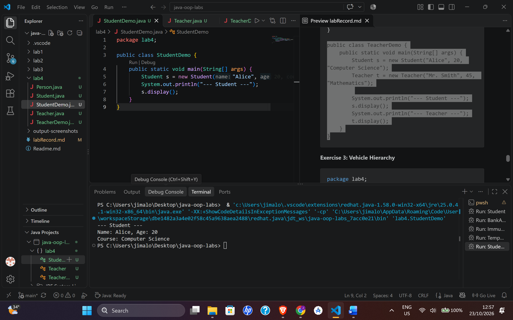

**Exercise 2: Teacher Subclass**

```Java
package lab4;

// Assuming Person and Student classes from Exercise 1 are in the same package

class Teacher extends Person {
    private String subject;

    public Teacher(String name, int age, String subject) {
        super(name, age);
        this.subject = subject;
    }

    @Override
    public void display() {
        super.display();
        System.out.println("Subject: " + subject);
    }
}

public class TeacherDemo {
    public static void main(String[] args) {
        Student s = new Student("Alice", 20, "Computer Science");
        Teacher t = new Teacher("Mr. Smith", 45, "Mathematics");
        
        System.out.println("--- Student ---");
        s.display();
        System.out.println("--- Teacher ---");
        t.display();
    }
}
```
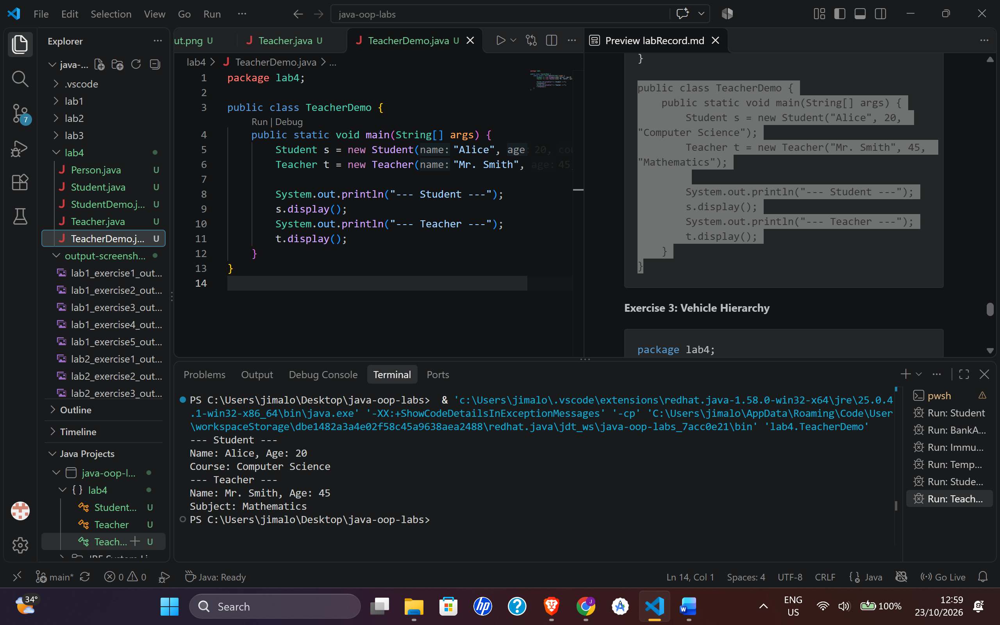

**Exercise 3: Vehicle Hierarchy**

```Java
package lab4;

class Vehicle {
    public Vehicle() { System.out.println("Vehicle Constructor"); }
}

class Car extends Vehicle {
    public Car() { System.out.println("Car Constructor"); }
}

class ElectricCar extends Car {
    public ElectricCar() { System.out.println("ElectricCar Constructor"); }

    public static void main(String[] args) {
        new ElectricCar();
    }
}
```
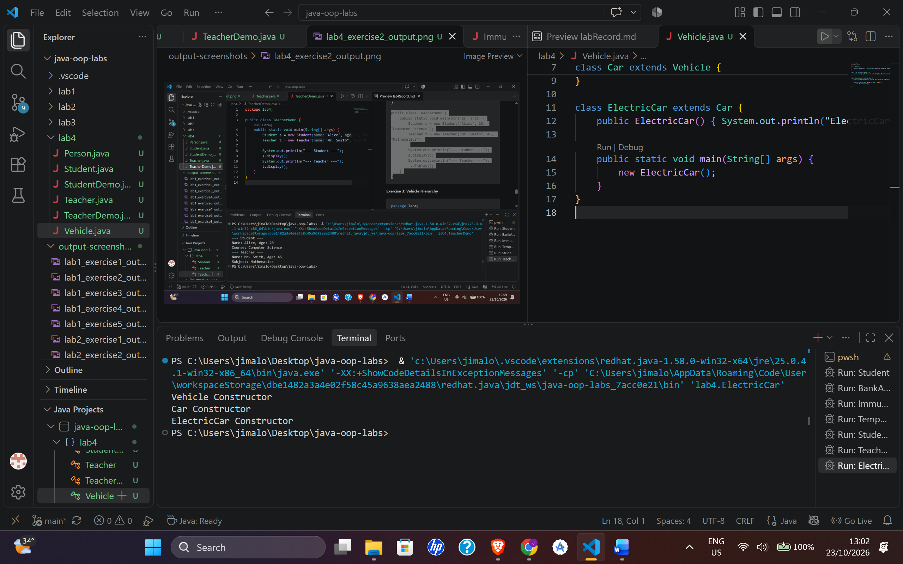

**Exercise 4: Superclass Constructor**

```Java
package lab4;

class Animal {
    private String name;
    
    public Animal(String name) {
        this.name = name;
    }
}

class Dog extends Animal {
    public Dog(String name) {
        // Must explicitly call the parent constructor that matches, 
        // otherwise Java tries to call a default super() which doesn't exist here.
        super(name); 
    }

    public static void main(String[] args) {
        Dog d = new Dog("Rex");
        System.out.println("Dog created successfully.");
    }
}
```
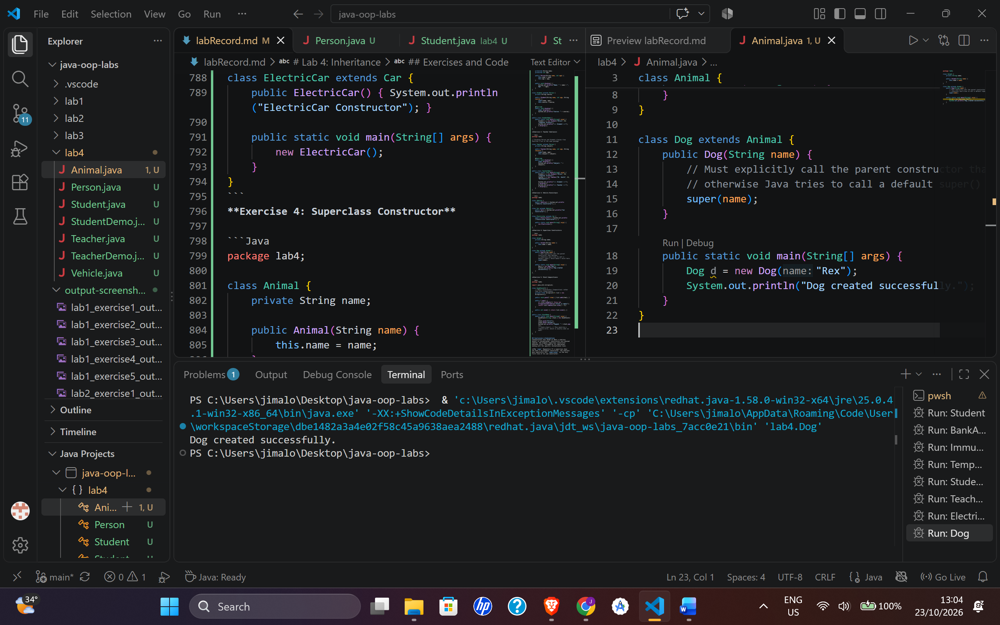

**Exercise 5: Stack Composition**

```Java
package lab4;

import java.util.ArrayList;

class GoodStack<T> {
    // HAS-A relationship (Composition) rather than IS-A (Inheritance)
    private final ArrayList<T> list = new ArrayList<>(); 

    public void push(T item) { list.add(item); }
    
    public T pop() { 
        if (list.isEmpty()) throw new IllegalStateException("Stack is empty");
        return list.remove(list.size() - 1); 
    }
    
    public int size() { return list.size(); }
}

public class StackDemo {
    public static void main(String[] args) {
        GoodStack<String> stack = new GoodStack<>();
        stack.push("First");
        stack.push("Second");
        System.out.println("Popped: " + stack.pop());
        // stack.clear(); // This would be a compile error, which is exactly what we want!
    }
}
```
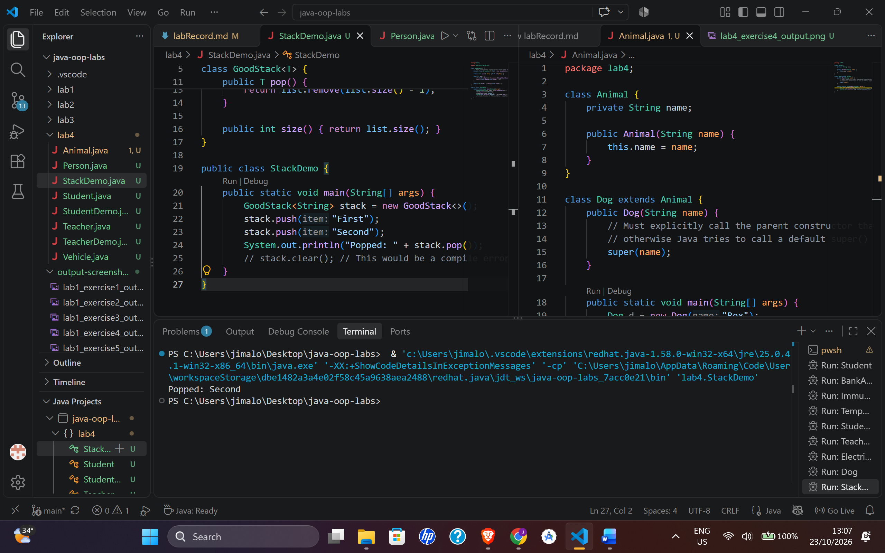
## Conclusions & Explanations
**Constructor Call Order:** When a subclass object is instantiated, constructors are chained upwards. The highest superclass constructor executes first, followed by its subclasses, ending with the specific instantiated class.

**The `super` Keyword:** If a superclass does not have a no-argument constructor, the subclass must explicitly call `super(args)` as the very first line of its own constructor.

**Composition over Inheritance:** Inheriting from `ArrayList` to build a Stack incorrectly exposes list methods like `.clear()` or `.remove(0)`. By using composition (storing the list as a private field), we restrict access and strictly enforce the Last-In-First-Out rule.


# Lab 5: Polymorphism

## Objectives

* Distinguish compile-time polymorphism (overloading) from run-time polymorphism (overriding).


* Use a superclass reference to hold subclass objects (upcasting) and explain dynamic method dispatch.


* Downcast safely with `instanceof` and pattern matching.


* Write code that works with new subclasses without modification.


## Exercises and Code

**Exercise 1: Overloaded Printer**

```java
package lab5;

public class Printer {
    public void print(int i) { System.out.println("Printing int: " + i); }
    public void print(double d) { System.out.println("Printing double: " + d); }
    public void print(String s) { System.out.println("Printing String: " + s); }
    public void print(int[] arr) { 
        System.out.print("Printing int array: ");
        for (int num : arr) System.out.print(num + " ");
        System.out.println();
    }

    public static void main(String[] args) {
        Printer p = new Printer();
        p.print(42);
        p.print(3.14);
        p.print("Polymorphism");
        p.print(new int[]{1, 2, 3});
    }
}

```

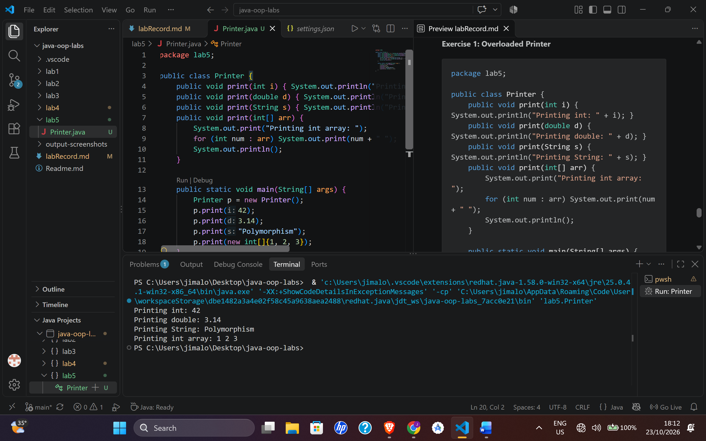

**Exercise 2: Animal Overriding**

```java
package lab5;

class Animal {
    void sound() { System.out.println("Generic animal sound"); }
}

class Cat extends Animal {
    @Override void sound() { System.out.println("Meow"); }
}

class Cow extends Animal {
    @Override void sound() { System.out.println("Moo"); }
}

class Duck extends Animal {
    @Override void sound() { System.out.println("Quack"); }
}

public class AnimalDemo {
    public static void main(String[] args) {
        Animal[] animals = { new Cat(), new Cow(), new Duck() };
        
        for (Animal a : animals) {
            a.sound();
        }
    }
}

```

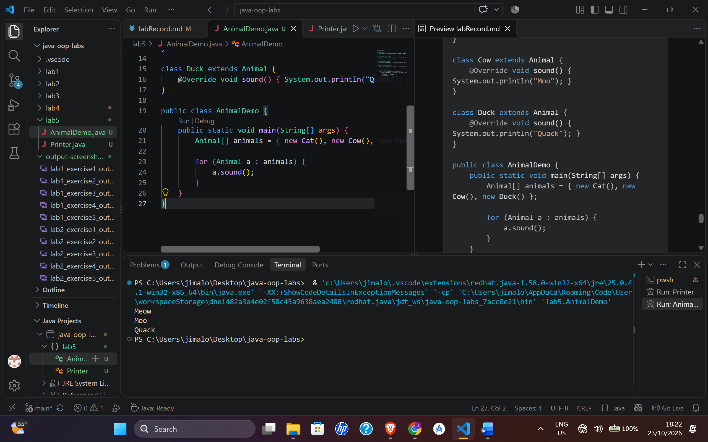
**Exercise 3: Polymorphic Payroll**

```java
package lab5;

class Employee {
    protected double baseSalary;
    public Employee(double baseSalary) { this.baseSalary = baseSalary; }
    public double calculatePay() { return baseSalary; }
}

class Manager extends Employee {
    private double bonus;
    public Manager(double baseSalary, double bonus) { super(baseSalary); this.bonus = bonus; }
    @Override public double calculatePay() { return baseSalary + bonus; }
}

class Developer extends Employee {
    private int overtimeHours;
    public Developer(double baseSalary, int overtimeHours) { super(baseSalary); this.overtimeHours = overtimeHours; }
    @Override public double calculatePay() { return baseSalary + (overtimeHours * 25.0); }
}

class Intern extends Employee {
    public Intern(double stipend) { super(stipend); }
    @Override public double calculatePay() { return baseSalary; } 
}

public class PayrollDemo {
    public static void main(String[] args) {
        Employee[] staff = {
            new Employee(2000),
            new Manager(3500, 800),
            new Developer(3000, 10),
            new Intern(500)
        };

        double totalPayroll = 0;
        for (Employee e : staff) {
            totalPayroll += e.calculatePay(); 
        }
        System.out.printf("Total Payroll: $%.2f%n", totalPayroll);
    }
}

```

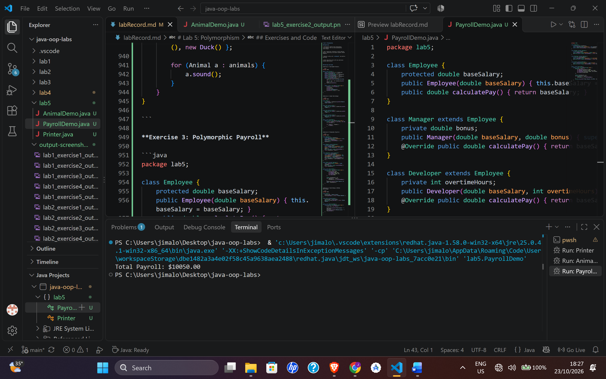
**Exercise 4: Field Hiding vs Method Overriding**

```java
package lab5;

class Parent {
    String type = "Parent Field";
    String getType() { return "Parent Method"; }
}

class Child extends Parent {
    String type = "Child Field"; 
    @Override String getType() { return "Child Method"; } 
}

public class ResolutionDemo {
    public static void main(String[] args) {
        Parent obj = new Child(); 
        
        System.out.println("Field access: " + obj.type);
        System.out.println("Method access: " + obj.getType());
    }
}

```

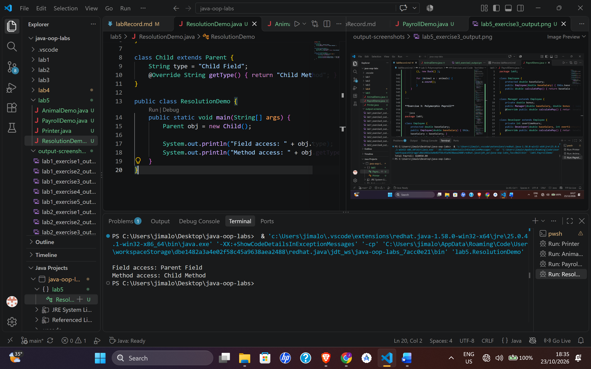
**Exercise 5: Refactoring `instanceof` to Polymorphism**

```java
package lab5;

interface Payment { void process(); }

class CardPayment implements Payment {
    @Override public void process() { System.out.println("Polymorphic: Card swiped"); }
}

class MobilePayment implements Payment {
    @Override public void process() { System.out.println("Polymorphic: Mobile scanned"); }
}

public class PaymentDemo {
    public static void main(String[] args) {
        Payment[] payments = { new CardPayment(), new MobilePayment() };
        for (Payment p : payments) {
            p.process();
        }
    }
}

```

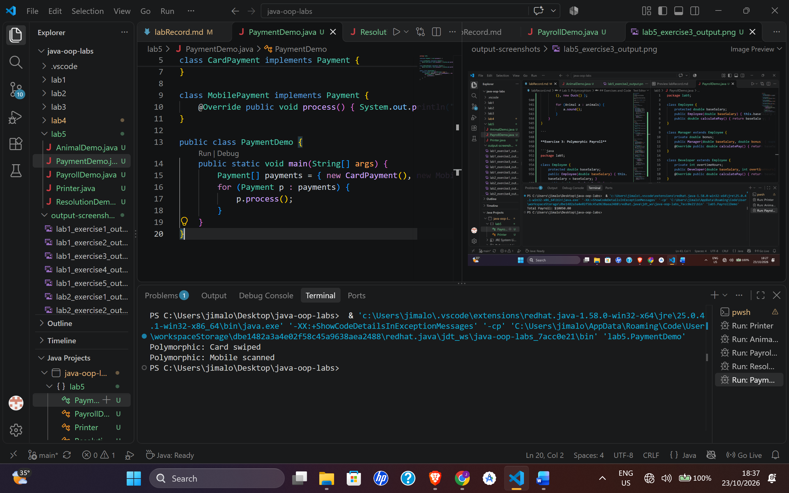

## Conclusions & Explanations

* **Overloading vs Overriding:** Overloading occurs at compile-time when methods share a name but differ in parameters within a single class. Overriding occurs at run-time (dynamic method dispatch), executing the method corresponding to the actual object instance.


* **Field Hiding vs Method Overriding:** Polymorphism applies only to instance methods, which are resolved at run-time. Fields are resolved at compile-time based on the declared variable type (`Parent`), demonstrating that fields are hidden rather than overridden.


* **Refactoring `instanceof`:** Replacing rigid type checks (`instanceof`) with polymorphic interface methods simplifies code and adheres to the Open/Closed Principle.


# Lab 6: Abstraction, Abstract Classes and Interfaces

## Objectives

* Define abstract classes and explain why they cannot be instantiated.


* Define and implement interfaces, including default and static methods.


* Choose correctly between an abstract class and an interface.


* Program to an interface, not to an implementation.


## Exercises and Code

**Exercise 1: Abstract Shapes**

```java
package lab6;

abstract class Shape {
    abstract double area();
    abstract double perimeter();
}

class Circle extends Shape {
    private double r;
    Circle(double r) { this.r = r; }
    @Override double area() { return Math.PI * r * r; }
    @Override double perimeter() { return 2 * Math.PI * r; }
}

class Rectangle extends Shape {
    private double w, h;
    Rectangle(double w, double h) { this.w = w; this.h = h; }
    @Override double area() { return w * h; }
    @Override double perimeter() { return 2 * (w + h); }
}

class Square extends Rectangle {
    Square(double side) { super(side, side); }
}

public class ShapeDemo {
    public static void main(String[] args) {
        Shape c = new Circle(5);
        Shape r = new Rectangle(4, 6);
        Shape s = new Square(4);
        
        System.out.printf("Circle Area: %.2f%n", c.area());
        System.out.printf("Rectangle Area: %.2f%n", r.area());
        System.out.printf("Square Area: %.2f%n", s.area());
    }
}

```
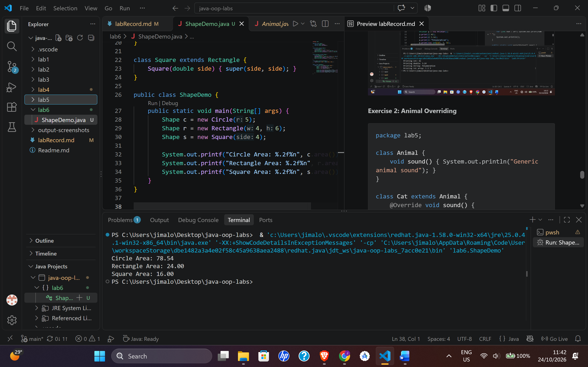

**Exercise 2: Flyable Interface**

```java
package lab6;

interface Flyable {
    void fly();
}

class Bird implements Flyable {
    @Override public void fly() { System.out.println("Bird flaps wings to fly."); }
}

class Aeroplane implements Flyable {
    @Override public void fly() { System.out.println("Aeroplane uses engines to fly."); }
}

public class FlightDemo {
    public static void main(String[] args) {
        Flyable[] flyers = { new Bird(), new Aeroplane() };
        for (Flyable f : flyers) {
            f.fly();
        }
    }
}

```

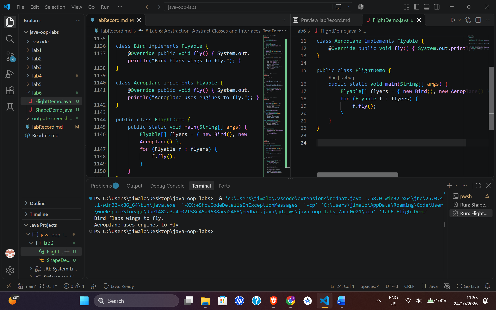
**Exercise 3: Account Hierarchy**

```java
package lab6;

abstract class Account {
    protected double balance;
    
    public Account(double balance) { this.balance = balance; }
    
    public void deposit(double amount) { 
        balance += amount; 
        System.out.println("Deposited " + amount + ". Balance: " + balance);
    }
    
    abstract void applyMonthlyFee();
}

class SavingsAccount extends Account {
    public SavingsAccount(double balance) { super(balance); }
    @Override void applyMonthlyFee() {
        balance -= 5.0; 
        System.out.println("Savings fee applied. Balance: " + balance);
    }
}

class CurrentAccount extends Account {
    public CurrentAccount(double balance) { super(balance); }
    @Override void applyMonthlyFee() {
        balance -= (balance * 0.01); 
        System.out.println("Current fee applied. Balance: " + balance);
    }
}

public class AccountDemo {
    public static void main(String[] args) {
        Account[] accounts = { new SavingsAccount(1000), new CurrentAccount(2000) };
        for (Account acc : accounts) {
            acc.deposit(100);
            acc.applyMonthlyFee();
        }
    }
}

```
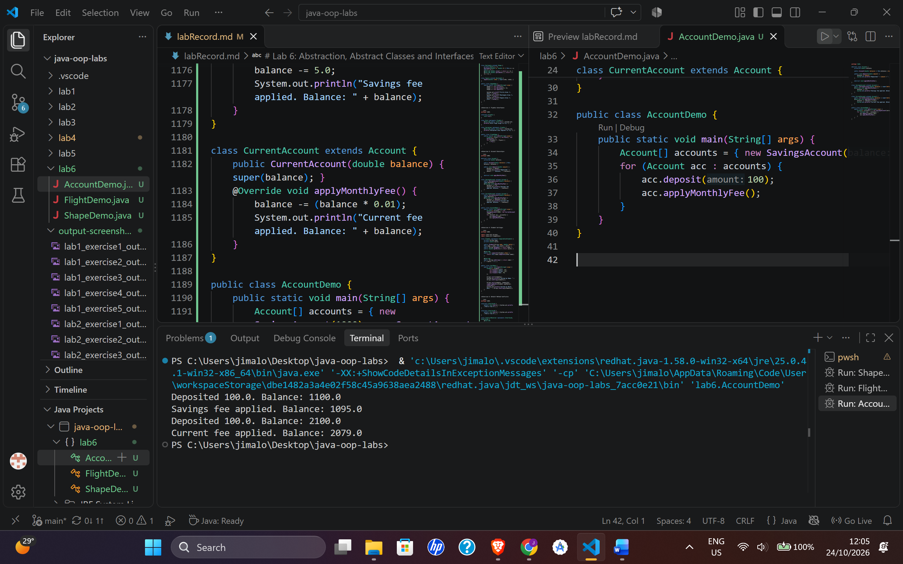
**Exercise 4: Student Sorting**

```java
package lab6;

import java.util.Arrays;
import java.util.Comparator;

class Student implements Comparable<Student> {
    private String name;
    private double marks;

    public Student(String name, double marks) { this.name = name; this.marks = marks; }
    public String getName() { return name; }
    public double getMarks() { return marks; }

    @Override
    public int compareTo(Student other) {
        return this.name.compareTo(other.name); 
    }

    @Override
    public String toString() { return name + "(" + marks + ")"; }
}

public class SortDemo {
    public static void main(String[] args) {
        Student[] students = {
            new Student("James", 85),
            new Student("Alice", 92),
            new Student("Bob", 78)
        };

        Arrays.sort(students);
        System.out.println("Sorted by Name: " + Arrays.toString(students));

        Arrays.sort(students, Comparator.comparingDouble(Student::getMarks).reversed());
        System.out.println("Sorted by Marks Desc: " + Arrays.toString(students));
    }
}

```
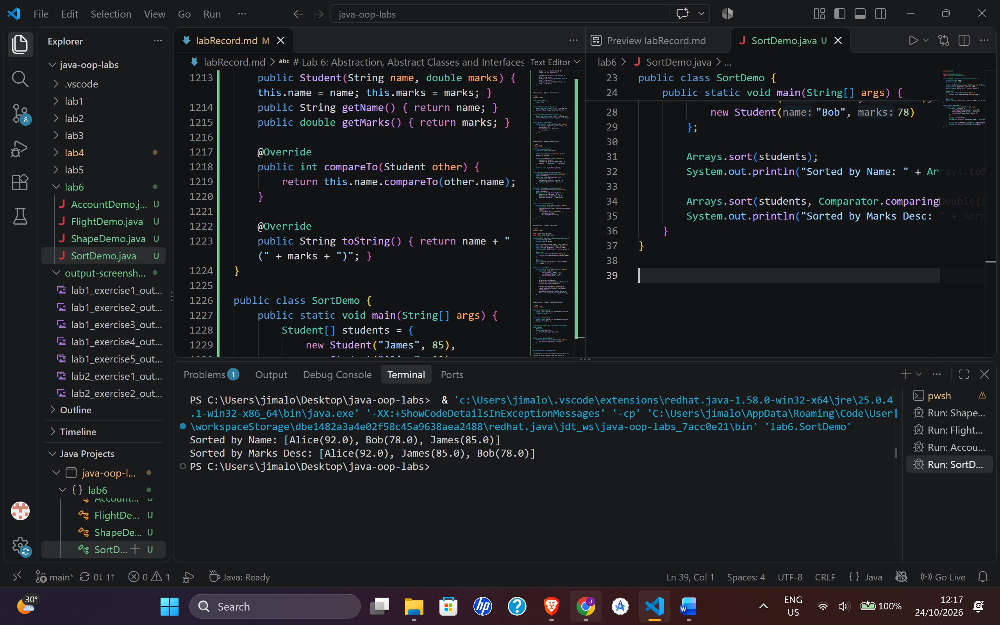
**Exercise 5: Default Method Conflict**

```java
package lab6;

interface InterfaceA {
    default void hello() { System.out.println("Hello from A"); }
}

interface InterfaceB {
    default void hello() { System.out.println("Hello from B"); }
}

class ConflictResolver implements InterfaceA, InterfaceB {
    @Override
    public void hello() {
        InterfaceA.super.hello(); 
    }
}

public class ConflictDemo {
    public static void main(String[] args) {
        new ConflictResolver().hello();
    }
}

```

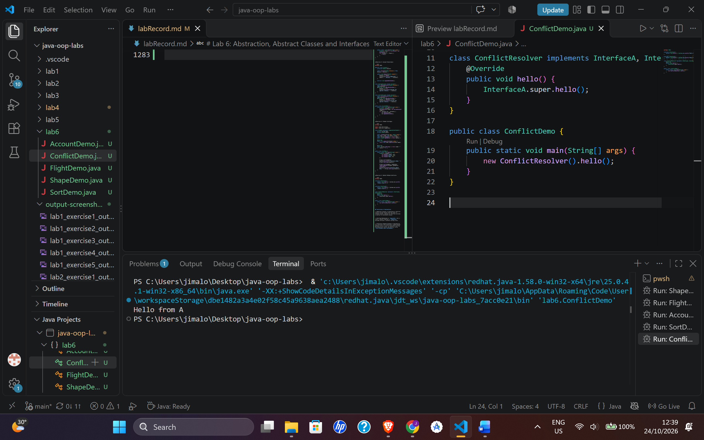
## Conclusions & Explanations

* **Abstract Classes vs Interfaces:** Abstract classes provide shared code and state to related classes, whereas an interface provides a contract to unrelated classes.


* **Sorting Mechanisms:** `Comparable` sets a class's natural ordering. A `Comparator` provides multiple, external sorting rules.


* **Interface Diamond Problem:** Implementing two interfaces with identically signed default methods forces a class to explicitly override the method and resolve the conflict using `InterfaceName.super.methodName()`.


# Lab 7: Exception Handling

## Objectives

* Explain the exception hierarchy and the difference between checked and unchecked exceptions.


* Use `try`, `catch`, `finally`, `throw`, and `throws` correctly.


* Create custom exception classes to handle domain-specific errors.


* Write robust programs that recover gracefully from runtime errors.


## Exercises and Code

**Exercise 1: Division Error Handling**

```java
package lab7;

import java.util.InputMismatchException;
import java.util.Scanner;

public class Divider {
    public static void main(String[] args) {
        Scanner sc = new Scanner(System.in);
        try {
            System.out.print("Enter numerator: ");
            int num = sc.nextInt();
            System.out.print("Enter denominator: ");
            int den = sc.nextInt();
            System.out.println("Result: " + (num / den));
        } catch (ArithmeticException e) {
            System.out.println("Error: Cannot divide by zero.");
        } catch (InputMismatchException e) {
            System.out.println("Error: Please enter valid integers.");
        } finally {
            sc.close();
            System.out.println("Scanner closed successfully.");
        }
    }
}

```

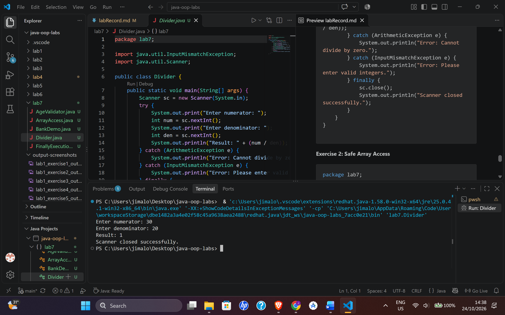

**Exercise 2: Safe Array Access**

```java
package lab7;

public class ArrayAccess {
    public static void main(String[] args) {
        int[] numbers = {10, 20, 30, 40, 50};
        
        try {
            System.out.println("Element at index 2: " + numbers[2]);
            System.out.println("Element at index 10: " + numbers[10]); // Out of bounds
        } catch (ArrayIndexOutOfBoundsException e) {
            System.out.println("Exception caught: Array index is out of bounds!");
        }
    }
}

```

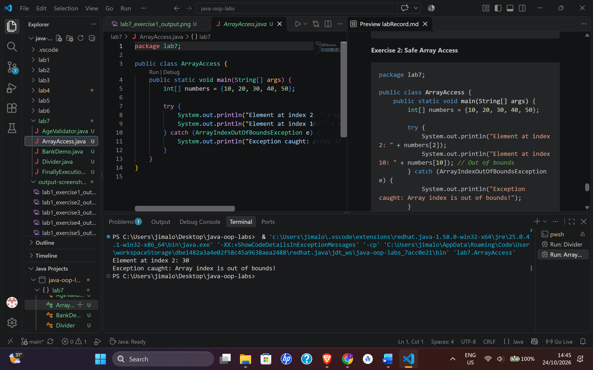

**Exercise 3: Custom Exception (InvalidAgeException)**

```java
package lab7;

class InvalidAgeException extends Exception {
    public InvalidAgeException(String message) {
        super(message);
    }
}

public class AgeValidator {
    static void validateAge(int age) throws InvalidAgeException {
        if (age < 0 || age > 120) {
            throw new InvalidAgeException("Age " + age + " is outside valid range (0-120).");
        }
        System.out.println("Valid age entered: " + age);
    }

    public static void main(String[] args) {
        try {
            validateAge(25);
            validateAge(150); // Triggers exception
        } catch (InvalidAgeException e) {
            System.out.println("Validation Caught: " + e.getMessage());
        }
    }
}

```

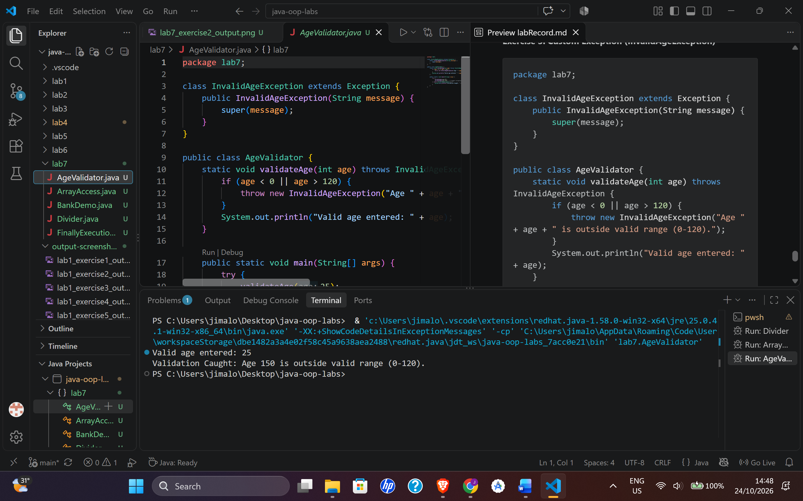

**Exercise 4: Bank Account Exceptions**

```java
package lab7;

class InsufficientFundsException extends Exception {
    public InsufficientFundsException(String message) {
        super(message);
    }
}

class BankAccount {
    private double balance;

    public BankAccount(double balance) {
        this.balance = balance;
    }

    public void withdraw(double amount) throws InsufficientFundsException {
        if (amount > balance) {
            throw new InsufficientFundsException("Cannot withdraw $" + amount + ". Current balance: $" + balance);
        }
        balance -= amount;
        System.out.println("Withdrew $" + amount + ". Remaining balance: $" + balance);
    }
}

public class BankDemo {
    public static void main(String[] args) {
        BankAccount acc = new BankAccount(100.00);
        
        try {
            acc.withdraw(40.00);
            acc.withdraw(80.00); // Throws InsufficientFundsException
        } catch (InsufficientFundsException e) {
            System.out.println("Transaction Error: " + e.getMessage());
        }
    }
}

```

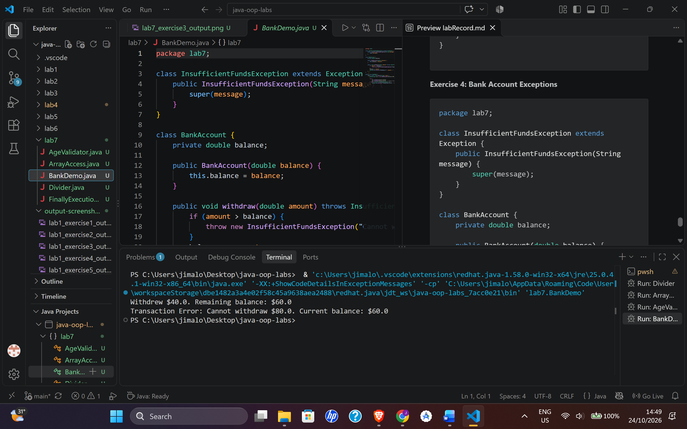

**Exercise 5: Execution Order in Try-Finally**

```java
package lab7;

public class FinallyExecutionDemo {
    static int testFinally() {
        try {
            System.out.println("Inside try block. Preparing to return 1...");
            return 1;
        } finally {
            System.out.println("Inside finally block. Executed BEFORE method actually returns!");
        }
    }

    public static void main(String[] args) {
        int result = testFinally();
        System.out.println("Method returned: " + result);
    }
}

```

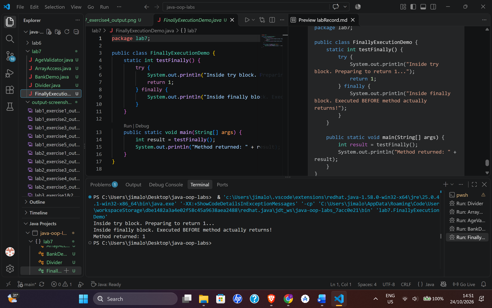

## Conclusions & Explanations

* **Catch Block Ordering:** Specific exception handlers (e.g., `ArithmeticException`) must be placed before more general catch blocks (e.g., `Exception`) so the most specific error handler processes the exception.


* **Checked vs. Unchecked Exceptions:** Checked exceptions (inheriting directly from `Exception`) require explicit handling or declaration via `throws`. Unchecked exceptions (inheriting from `RuntimeException`) represent programming logic faults.


* **Exceptions vs. Return Codes:** Throwing domain exceptions like `InsufficientFundsException` prevents code callers from silently ignoring failed actions, enforcing strict program guarantees.


* **Guarantee of `finally`:** The `finally` block is guaranteed to execute even if the `try` block contains an explicit `return` statement, suspending the return until cleanup completes.


# Lab 8: Generics and the Collections Framework

## Objectives

* Write generic classes, methods, and bounded type parameters.
* Explain type erasure and why primitive types require wrapper classes.
* Select and use appropriate Collection framework classes (`List`, `Set`, `Map`).
* Implement custom sorting algorithms using `Comparable` and `Comparator`.

## Exercises and Code

**Exercise 1: List Operations and Collections Utility**

```java
package lab8;

import java.util.ArrayList;
import java.util.Collections;
import java.util.List;

public class ListDemo {
    public static void main(String[] args) {
        List<Integer> numbers = new ArrayList<>(List.of(5, 12, 18, 3, 25, 9));
        
        int sum = 0;
        int max = Integer.MIN_VALUE;

        for (int num : numbers) {
            sum += num;
            if (num > max) {
                max = num;
            }
        }

        System.out.println("Original List: " + numbers);
        System.out.println("Sum of elements: " + sum);
        System.out.println("Maximum element: " + max);

        Collections.reverse(numbers);
        System.out.println("Reversed List: " + numbers);
    }
}

```

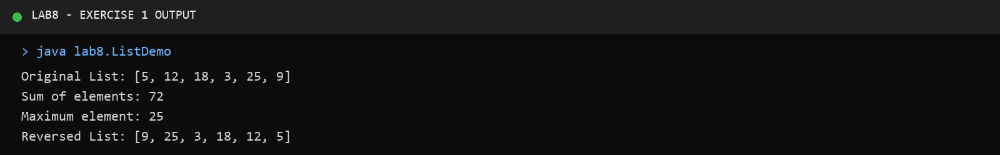

**Exercise 2: Set Operations (Deduplication)**

```java
package lab8;

import java.util.ArrayList;
import java.util.HashSet;
import java.util.List;
import java.util.Set;

public class SetDemo {
    public static void main(String[] args) {
        List<String> rawNames = List.of("Tariro", "Kuda", "Tariro", "Farai", "Kuda", "Tendai");
        System.out.println("Raw List with duplicates: " + rawNames);

        Set<String> uniqueNames = new HashSet<>(rawNames);
        System.out.println("Set with duplicates removed: " + uniqueNames);
    }
}

```

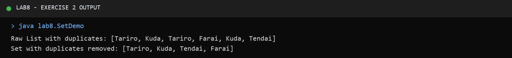

**Exercise 3: Generic Stack**

```java
package lab8;

import java.util.ArrayList;
import java.util.List;

class GenericStack<T> {
    private final List<T> elements = new ArrayList<>();

    public void push(T item) {
        elements.add(item);
    }

    public T pop() {
        if (isEmpty()) {
            throw new IllegalStateException("Cannot pop from an empty stack.");
        }
        return elements.remove(elements.size() - 1);
    }

    public T peek() {
        if (isEmpty()) {
            throw new IllegalStateException("Cannot peek an empty stack.");
        }
        return elements.get(elements.size() - 1);
    }

    public boolean isEmpty() {
        return elements.isEmpty();
    }
}

public class StackTest {
    public static void main(String[] args) {
        GenericStack<String> stringStack = new GenericStack<>();
        stringStack.push("Java");
        stringStack.push("OOP");
        System.out.println("Popped string: " + stringStack.pop());

        GenericStack<Integer> intStack = new GenericStack<>();
        intStack.push(100);
        intStack.push(200);
        System.out.println("Top integer: " + intStack.peek());
    }
}

```

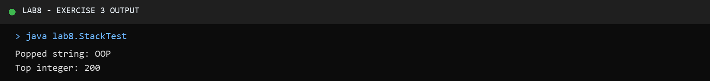

**Exercise 4: Word Frequency Map**

```java
package lab8;

import java.util.ArrayList;
import java.util.HashMap;
import java.util.List;
import java.util.Map;

public class WordFrequency {
    public static void main(String[] args) {
        String sentence = "the quick brown fox jumps over the lazy dog the fox";
        Map<String, Integer> frequencyMap = new HashMap<>();

        for (String word : sentence.split(" ")) {
            frequencyMap.put(word, frequencyMap.getOrDefault(word, 0) + 1);
        }

        List<Map.Entry<String, Integer>> entryList = new ArrayList<>(frequencyMap.entrySet());
        entryList.sort(Map.Entry.<String, Integer>comparingByValue().reversed());

        System.out.println("Word Frequencies (Highest to Lowest):");
        for (Map.Entry<String, Integer> entry : entryList) {
            System.out.println(entry.getKey() + ": " + entry.getValue());
        }
    }
}

```

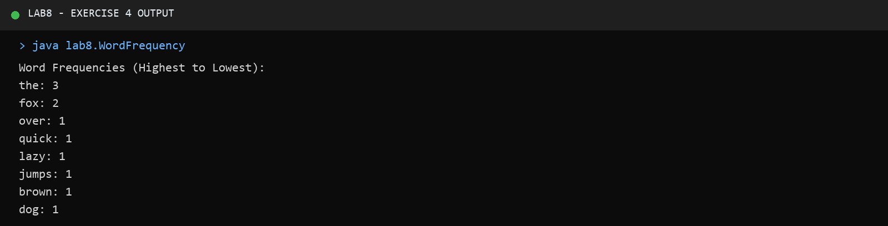

**Exercise 5: Generic Sort with Bounded Type Parameters**

```java
package lab8;

import java.util.Arrays;

public class GenericSorter {
    public static <T extends Comparable<T>> void bubbleSort(T[] array) {
        int n = array.length;
        for (int i = 0; i < n - 1; i++) {
            for (int j = 0; j < n - i - 1; j++) {
                if (array[j].compareTo(array[j + 1]) > 0) {
                    T temp = array[j];
                    array[j] = array[j + 1];
                    array[j + 1] = temp;
                }
            }
        }
    }

    public static void main(String[] args) {
        Integer[] numbers = {42, 12, 89, 27, 5};
        bubbleSort(numbers);
        System.out.println("Sorted Integers: " + Arrays.toString(numbers));

        String[] names = {"Tendai", "Alice", "Kuda", "Bob"};
        bubbleSort(names);
        System.out.println("Sorted Strings: " + Arrays.toString(names));
    }
}

```

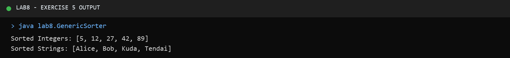

## Conclusions & Explanations

* **Type Erasure:** Java generics perform strict compile-time type checks and erase type parameters at runtime. Because generics compile down to `Object` references, primitive types cannot be used directly with generics and require wrapper classes (e.g., `Integer` instead of `int`).
* **Collection Choice:** `List` preserves insertion order and permits duplicates, `Set` guarantees uniqueness by suppressing duplicate entries, and `Map` stores key-value associations for high-performance lookup.
* **Bounded Type Parameters:** The syntax `<T Comparable<T extends>>` restricts generic parameter types to classes that implement `Comparable`, guaranteeing the compiler that `.compareTo()` can be safely invoked inside the sorting logic.

# Lab 9: Nested Types, Enums, and Records

## Objectives

* Model fixed sets of constants and state using type-safe Java `enum` types.


* Create immutable data-carrier classes with Java `record` constructs.


* Overriding `equals`, `hashCode`, and `toString` to maintain contract consistency in collections.


* Understand the practical differences between member inner classes and static nested classes.


## Exercises and Code

**Exercise 1: Enum with Custom Properties and Logic**

```java
package lab9;

enum Severity {
    LOW("Minor issue, system operating normally."),
    MEDIUM("Moderate issue, monitoring required."),
    HIGH("Critical failure, immediate intervention needed!");

    private final String description;

    Severity(String description) {
        this.description = description;
    }

    public String getDescription() {
        return description;
    }
}

public class EnumDemo {
    public static void main(String[] args) {
        Severity level = Severity.HIGH;

        switch (level) {
            case LOW -> System.out.println("Status: Low - " + level.getDescription());
            case MEDIUM -> System.out.println("Status: Medium - " + level.getDescription());
            case HIGH -> System.out.println("Status: High - " + level.getDescription());
        }
    }
}

```

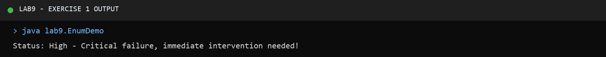

**Exercise 2: Immutable Record Class**

```java
package lab9;

record StudentRecord(String name, int rollNumber, double gpa) {
    public StudentRecord {
        if (gpa < 0.0 || gpa > 4.0) {
            throw new IllegalArgumentException("GPA must be between 0.0 and 4.0");
        }
    }
}

public class RecordDemo {
    public static void main(String[] args) {
        StudentRecord s1 = new StudentRecord("James", 101, 3.8);
        StudentRecord s2 = new StudentRecord("James", 101, 3.8);

        System.out.println("Student Details: " + s1);
        System.out.println("s1 equals s2: " + s1.equals(s2));
        System.out.println("s1 HashCode: " + s1.hashCode());
    }
}

```

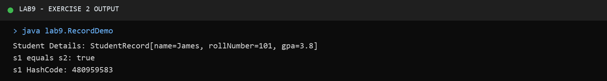

**Exercise 3: Overriding Equals and HashCode Contract**

```java
package lab9;

import java.util.HashSet;
import java.util.Objects;
import java.util.Set;

class Book {
    private final String isbn;
    private final String title;

    public Book(String isbn, String title) {
        this.isbn = isbn;
        this.title = title;
    }

    @Override
    public boolean equals(Object o) {
        if (this == o) return true;
        if (!(o instanceof Book book)) return false;
        return Objects.equals(isbn, book.isbn);
    }

    @Override
    public int hashCode() {
        return Objects.hash(isbn);
    }

    @Override
    public String toString() {
        return title + " (ISBN: " + isbn + ")";
    }
}

public class BookSetDemo {
    public static void main(String[] args) {
        Set<Book> library = new HashSet<>();
        library.add(new Book("978-0134685991", "Effective Java"));
        library.add(new Book("978-0134685991", "Effective Java (Duplicate)"));

        System.out.println("Unique Books in Set: " + library.size());
        System.out.println("Collection Content: " + library);
    }
}

```

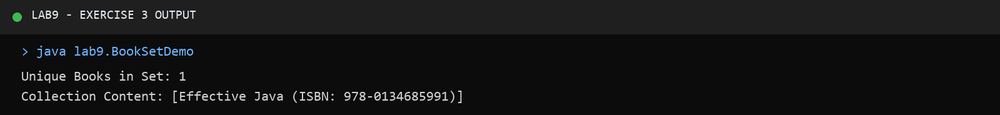

**Exercise 4: Member Inner vs. Static Nested Classes**

```java
package lab9;

class Outer {
    private final String outerMessage = "Data from Outer Class";

    class Inner {
        void display() {
            System.out.println("Inner class accessing: " + outerMessage);
        }
    }

    static class StaticNested {
        void display() {
            System.out.println("Static nested class instantiated independently.");
        }
    }
}

public class NestedDemo {
    public static void main(String[] args) {
        Outer outer = new Outer();
        Outer.Inner inner = outer.new Inner();
        inner.display();

        Outer.StaticNested staticNested = new Outer.StaticNested();
        staticNested.display();
    }
}

```

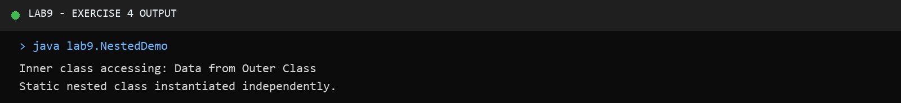

**Exercise 5: Complex Enum with Change Calculation Algorithm**

```java
package lab9;

enum Coin {
    QUARTER(25), DIME(10), NICKEL(5), PENNY(1);

    private final int value;

    Coin(int value) {
        this.value = value;
    }

    public int getValue() {
        return value;
    }

    public static void fewestCoins(int cents) {
        System.out.print(cents + " cents = ");
        for (Coin coin : Coin.values()) {
            int count = cents / coin.getValue();
            if (count > 0) {
                System.out.print(count + " " + coin.name() + "(s) ");
                cents %= coin.getValue();
            }
        }
        System.out.println();
    }
}

public class CoinDemo {
    public static void main(String[] args) {
        Coin.fewestCoins(87);
        Coin.fewestCoins(42);
    }
}

```

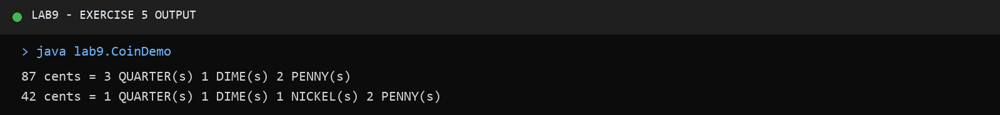

## Conclusions & Explanations

* **Record Immutability:** Java `record` classes eliminate standard boilerplate by automatically generating `private final` fields, constructors, accessors, `equals()`, `hashCode()`, and `toString()`.


* **The Contract of `equals` and `hashCode`:** If two objects evaluate as equal via `equals()`, they must share identical `hashCode()` integer outputs. Overriding both based on a key field (like ISBN) ensures correct deduplication in hash collections like `HashSet`.


* **Enums with State and Logic:** Enums are full-fledged type-safe classes with fixed instances. Encapsulating attributes and static methods within an enum (e.g., `Coin`) makes complex constant-based logic clean and centralized.


* **Inner vs. Static Nested Classes:** Member inner classes retain an implicit reference to an instance of the outer class, whereas static nested classes operate independently without requiring outer object instantiation.


# Lab 10: File I/O, Lambdas, and Streams

## Objectives

* Read and write text files safely using `java.nio.file.Files` and `Path` while handling `IOException`.
* Implement lambda expressions and work with standard functional interfaces (`Predicate`, `Consumer`, `Function`).
* Declaratively process collections using Stream API operations (`filter`, `map`, `sorted`, `collect`).
* Perform complex data grouping and pipeline aggregations using Stream collectors.

## Exercises and Code

**Exercise 1: File Reading and Writing with NIO.2**

```java
package lab10;

import java.io.IOException;
import java.nio.file.Files;
import java.nio.file.Path;
import java.util.List;

public class FileIoDemo {
    public static void main(String[] args) {
        Path filePath = Path.of("sample_output.txt");
        List<String> linesToWrite = List.of(
            "Header: Java OOP Lab Data",
            "Line 1: File I/O using java.nio.file",
            "Line 2: Demonstrating text persistence",
            "Line 3: Stream and Lambda processing"
        );

        try {
            // Write lines to file
            Files.write(filePath, linesToWrite);
            System.out.println("Successfully wrote data to " + filePath.toAbsolutePath());

            // Read lines back from file
            List<String> readLines = Files.readAllLines(filePath);
            System.out.println("\n--- Reading Content From File ---");
            for (String line : readLines) {
                System.out.println(line);
            }
        } catch (IOException e) {
            System.err.println("File operation failed: " + e.getMessage());
        }
    }
}

```

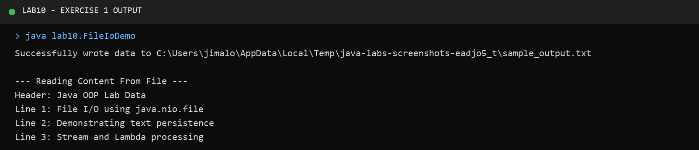

**Exercise 2: Lambda Expressions and Functional Interfaces**

```java
package lab10;

import java.util.ArrayList;
import java.util.List;
import java.util.function.Consumer;
import java.util.function.Function;
import java.util.function.Predicate;

public class LambdaDemo {
    public static void main(String[] args) {
        List<Integer> numbers = new ArrayList<>(List.of(12, 5, 20, 8, 15, 3, 30));

        // Predicate functional interface
        Predicate<Integer> isEven = n -> n % 2 == 0;
        
        // Function functional interface
        Function<Integer, String> formatter = n -> "Value: " + n;

        // Consumer functional interface
        Consumer<String> printer = System.out.println;

        System.out.println("Original Numbers: " + numbers);
        
        // Remove odd numbers using Predicate
        numbers.removeIf(n -> !isEven.test(n));
        System.out.println("Even Numbers Only: " + numbers);

        // Format and print using Function and Consumer
        for (Integer num : numbers) {
            printer.accept(formatter.apply(num));
        }
    }
}

```

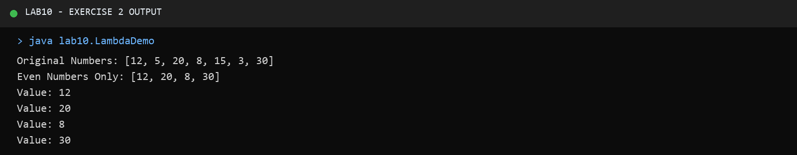

**Exercise 3: Stream Pipeline Basics (Filter, Map, Collect)**

```java
package lab10;

import java.util.List;
import java.util.stream.Collectors;

public class StreamBasics {
    public static void main(String[] args) {
        List<String> names = List.of("Tariro", "Bob", "Farai", "An", "Nyasha", "Kuda", "Jo");

        // Process stream: filter names longer than 3 characters, convert to uppercase, and sort
        List<String> processedNames = names.stream()
            .filter(name -> name.length() > 3)
            .map(String::toUpperCase)
            .sorted()
            .collect(Collectors.toList());

        System.out.println("Original Names: " + names);
        System.out.println("Filtered (>3 chars), Uppercased, and Sorted: " + processedNames);
    }
}

```

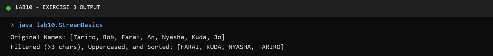

**Exercise 4: Stream Aggregations and Record Statistics**

```java
package lab10;

import java.util.Comparator;
import java.util.List;
import java.util.stream.Collectors;

record Student(String name, double gpa) {}

public class StreamStats {
    public static void main(String[] args) {
        List<Student> students = List.of(
            new Student("Tariro", 3.8),
            new Student("Farai", 2.9),
            new Student("Rudo", 3.9),
            new Student("Kuda", 3.1),
            new Student("Tendai", 3.5)
        );

        // Compute class average GPA using mapToDouble and average
        double avgGpa = students.stream()
            .mapToDouble(Student::gpa)
            .average()
            .orElse(0.0);

        System.out.printf("Class Average GPA: %.2f%n", avgGpa);

        // Filter students above average GPA, sort by name, and map to name list
        List<String> topPerformers = students.stream()
            .filter(s -> s.gpa() > avgGpa)
            .sorted(Comparator.comparing(Student::name))
            .map(Student::name)
            .collect(Collectors.toList());

        System.out.println("Above Average Students: " + topPerformers);
    }
}

```

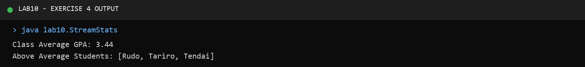

**Exercise 5: Grouping Streams and Writing to CSV Files**

```java
package lab10;

import java.io.IOException;
import java.nio.file.Files;
import java.nio.file.Path;
import java.util.List;
import java.util.Map;
import java.util.stream.Collectors;

record Learner(String name, int rollNumber, double gpa) {
    public String getGradeBand() {
        if (gpa >= 3.5) return "A";
        if (gpa >= 3.0) return "B";
        return "C";
    }
}

public class CsvGrouper {
    public static void main(String[] args) {
        List<Learner> learners = List.of(
            new Learner("Alice", 101, 3.9),
            new Learner("Kuda", 102, 3.2),
            new Learner("Lynn", 103, 2.5),
            new Learner("Ben", 104, 3.6),
            new Learner("Tariro", 105, 2.8)
        );

        // Group learners by Grade Band using Collectors.groupingBy
        Map<String, List<Learner>> grouped = learners.stream()
            .collect(Collectors.groupingBy(Learner::getGradeBand));

        // Output grouped records to individual CSV files
        grouped.forEach((band, list) -> {
            Path file = Path.of("Band_" + band + ".csv");
            List<String> csvLines = list.stream()
                .map(l -> l.name() + "," + l.rollNumber() + "," + l.gpa())
                .collect(Collectors.toList());
            
            try {
                Files.write(file, csvLines);
                System.out.println("Wrote Grade Band " + band + " (" + csvLines.size() + " records) to " + file);
            } catch (IOException e) {
                System.err.println("Failed to write CSV for band " + band + ": " + e.getMessage());
            }
        });
    }
}

```

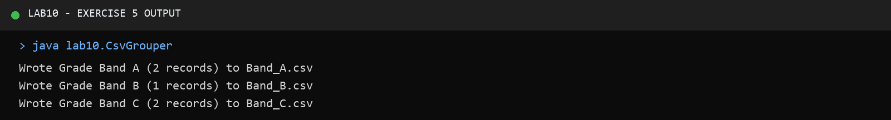

## Conclusions & Explanations

* **Modern File I/O (`java.nio.file`):** Using `Files.write()` and `Files.readAllLines()` alongside `Path` provides a modern, robust, and concise API for file management that automatically handles stream allocation and resource disposal.
* **Lambdas and Functional Interfaces:** Lambda expressions provide clear, inline implementations for single-abstract-method interfaces (`Predicate`, `Consumer`, `Function`), enabling functional programming patterns in Java.
* **Declarative Processing with Streams:** The Stream API separates processing logic into lazy intermediate operations (`filter`, `map`, `sorted`) and terminal operations (`collect`, `average`), allowing data pipelines to be written declaratively without explicit index loops.
* **Advanced Collectors:** Functions like `Collectors.groupingBy()` streamline complex categorization operations, organizing collection streams into categorized `Map` data structures in a single readable operation.


# Lab 11: Design Patterns and Mini-Project

## Objectives

* Identify and implement core creational, structural, and behavioral design patterns (Singleton, Factory Method, Strategy, Observer).


* Apply SOLID design principles to decouple software components and reduce system complexity.


* Integrate OOP fundamentals, custom exception handling, generic collections, lambdas/streams, and file I/O into a cohesive mini-project.


## Exercises and Code

**Exercise 1: Singleton Pattern (Configuration Manager)**

```java
package lab11;

public class ConfigurationManager {
    private static ConfigurationManager instance;
    private String appName;
    private int maxBorrowLimit;

    private ConfigurationManager() {
        // Private constructor prevents direct external instantiation
        this.appName = "HIT Central Library System";
        this.maxBorrowLimit = 3;
    }

    public static synchronized ConfigurationManager getInstance() {
        if (instance == null) {
            instance = new ConfigurationManager();
        }
        return instance;
    }

    public String getAppName() { return appName; }
    public int getMaxBorrowLimit() { return maxBorrowLimit; }

    public static void main(String[] args) {
        ConfigurationManager config1 = ConfigurationManager.getInstance();
        ConfigurationManager config2 = ConfigurationManager.getInstance();

        System.out.println("App Name: " + config1.getAppName());
        System.out.println("Max Borrow Limit: " + config1.getMaxBorrowLimit());
        System.out.println("config1 and config2 point to exact same instance? " + (config1 == config2));
    }
}

```

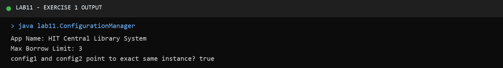

**Exercise 2: Factory Method Pattern (Library Item Creation)**

```java
package lab11;

abstract class LibraryItem {
    private final String id;
    private final String title;

    public LibraryItem(String id, String title) {
        this.id = id;
        this.title = title;
    }

    public String getId() { return id; }
    public String getTitle() { return title; }
    public abstract String getItemType();
}

class Book extends LibraryItem {
    public Book(String id, String title) { super(id, title); }
    @Override public String getItemType() { return "Book"; }
}

class Dvd extends LibraryItem {
    public Dvd(String id, String title) { super(id, title); }
    @Override public String getItemType() { return "DVD"; }
}

class ItemFactory {
    public static LibraryItem createItem(String type, String id, String title) {
        if (type.equalsIgnoreCase("BOOK")) {
            return new Book(id, title);
        } else if (type.equalsIgnoreCase("DVD")) {
            return new Dvd(id, title);
        }
        throw new IllegalArgumentException("Unknown item type: " + type);
    }
}

public class FactoryDemo {
    public static void main(String[] args) {
        LibraryItem item1 = ItemFactory.createItem("BOOK", "B101", "Design Patterns");
        LibraryItem item2 = ItemFactory.createItem("DVD", "D201", "Java Video Course");

        System.out.println("Created: " + item1.getTitle() + " (" + item1.getItemType() + ")");
        System.out.println("Created: " + item2.getTitle() + " (" + item2.getItemType() + ")");
    }
}

```

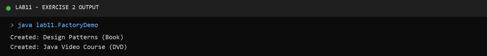

**Exercise 3: Strategy Pattern (Fine Calculation)**

```java
package lab11;

interface FineStrategy {
    double calculateFine(int daysOverdue);
}

class StandardFineStrategy implements FineStrategy {
    @Override
    public double calculateFine(int daysOverdue) {
        return daysOverdue * 1.50; // $1.50 per day
    }
}

class StudentFineStrategy implements FineStrategy {
    @Override
    public double calculateFine(int daysOverdue) {
        return daysOverdue * 0.50; // Discounted $0.50 per day
    }
}

class FineCalculator {
    private FineStrategy strategy;

    public FineCalculator(FineStrategy strategy) {
        this.strategy = strategy;
    }

    public void setStrategy(FineStrategy strategy) {
        this.strategy = strategy;
    }

    public double compute(int days) {
        return strategy.calculateFine(days);
    }
}

public class StrategyDemo {
    public static void main(String[] args) {
        FineCalculator calculator = new FineCalculator(new StandardFineStrategy());
        System.out.printf("Standard Fine for 5 days: $%.2f%n", calculator.compute(5));

        calculator.setStrategy(new StudentFineStrategy());
        System.out.printf("Student Fine for 5 days: $%.2f%n", calculator.compute(5));
    }
}

```

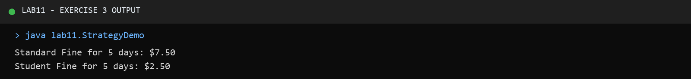

**Exercise 4: Observer Pattern (Availability Notifications)**

```java
package lab11;

import java.util.ArrayList;
import java.util.List;

interface Observer {
    void update(String message);
}

class MemberObserver implements Observer {
    private final String name;

    public MemberObserver(String name) {
        this.name = name;
    }

    @Override
    public void update(String message) {
        System.out.println("Notification for " + name + ": " + message);
    }
}

class ItemSubject {
    private final List<Observer> observers = new ArrayList<>();
    private final String itemTitle;

    public ItemSubject(String itemTitle) {
        this.itemTitle = itemTitle;
    }

    public void addObserver(Observer observer) {
        observers.add(observer);
    }

    public void notifyObservers(String status) {
        for (Observer obs : observers) {
            obs.update("The item '" + itemTitle + "' is now " + status + ".");
        }
    }
}

public class ObserverDemo {
    public static void main(String[] args) {
        ItemSubject bookSubject = new ItemSubject("Clean Code");
        
        MemberObserver m1 = new MemberObserver("James");
        MemberObserver m2 = new MemberObserver("Tariro");

        bookSubject.addObserver(m1);
        bookSubject.addObserver(m2);

        bookSubject.notifyObservers("AVAILABLE");
    }
}

```

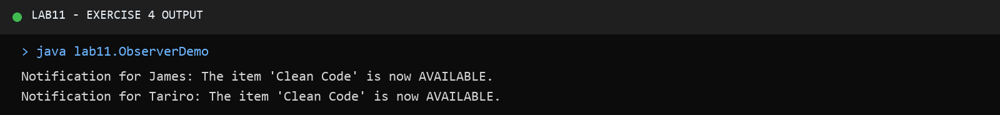

**Exercise 5: Comprehensive Library Management System (Mini-Project)**

```java
package lab11;

import java.io.IOException;
import java.nio.file.Files;
import java.nio.file.Path;
import java.util.*;
import java.util.stream.Collectors;

// --- CUSTOM EXCEPTIONS ---
class ItemNotAvailableException extends Exception {
    public ItemNotAvailableException(String message) { super(message); }
}

class MemberLimitExceededException extends Exception {
    public MemberLimitExceededException(String message) { super(message); }
}

// --- INTERFACES & ABSTRACTIONS ---
interface Borrowable {
    void borrowItem(Member member) throws ItemNotAvailableException, MemberLimitExceededException;
    void returnItem(Member member);
}

abstract class SystemItem implements Borrowable {
    private final String id;
    private final String title;
    private boolean available = true;

    public SystemItem(String id, String title) {
        this.id = id;
        this.title = title;
    }

    public String getId() { return id; }
    public String getTitle() { return title; }
    public boolean isAvailable() { return available; }
    public void setAvailable(boolean available) { this.available = available; }

    public abstract int getLoanPeriodDays();
    public String toCsv() { return id + "," + title + "," + available; }
}

class BookItem extends SystemItem {
    public BookItem(String id, String title) { super(id, title); }
    @Override public int getLoanPeriodDays() { return 14; }

    @Override
    public void borrowItem(Member member) throws ItemNotAvailableException, MemberLimitExceededException {
        if (!isAvailable()) {
            throw new ItemNotAvailableException("Item '" + getTitle() + "' is currently checked out.");
        }
        if (member.getBorrowedItems().size() >= ConfigurationManager.getInstance().getMaxBorrowLimit()) {
            throw new MemberLimitExceededException("Member " + member.getName() + " reached maximum borrowing limit.");
        }
        setAvailable(false);
        member.addLoan(this);
    }

    @Override
    public void returnItem(Member member) {
        setAvailable(true);
        member.removeLoan(this);
    }
}

class Member {
    private final String id;
    private final String name;
    private final List<SystemItem> borrowedItems = new ArrayList<>();

    public Member(String id, String name) {
        this.id = id;
        this.name = name;
    }

    public String getId() { return id; }
    public String getName() { return name; }
    public List<SystemItem> getBorrowedItems() { return borrowedItems; }

    public void addLoan(SystemItem item) { borrowedItems.add(item); }
    public void removeLoan(SystemItem item) { borrowedItems.remove(item); }
    public String toCsv() { return id + "," + name; }
}

// --- CORE SYSTEM MANAGER ---
public class LibrarySystem {
    private final Map<String, SystemItem> catalog = new HashMap<>();
    private final Map<String, Member> members = new HashMap<>();

    public void registerItem(SystemItem item) { catalog.put(item.getId(), item); }
    public void registerMember(Member member) { members.put(member.getId(), member); }

    public void processBorrow(String memberId, String itemId) {
        try {
            Member m = members.get(memberId);
            SystemItem item = catalog.get(itemId);

            if (m == null || item == null) {
                throw new IllegalArgumentException("Invalid Member ID or Item ID.");
            }

            item.borrowItem(m);
            System.out.println("Success: " + m.getName() + " borrowed '" + item.getTitle() + "'");
        } catch (ItemNotAvailableException | MemberLimitExceededException | IllegalArgumentException e) {
            System.err.println("Borrow Failed: " + e.getMessage());
        }
    }

    public List<SystemItem> searchByTitle(String query) {
        return catalog.values().stream()
            .filter(item -> item.getTitle().toLowerCase().contains(query.toLowerCase()))
            .sorted(Comparator.comparing(SystemItem::getTitle))
            .collect(Collectors.toList());
    }

    public void saveSystemState() {
        try {
            List<String> itemLines = catalog.values().stream().map(SystemItem::toCsv).toList();
            Files.write(Path.of("catalog_data.csv"), itemLines);

            List<String> memberLines = members.values().stream().map(Member::toCsv).toList();
            Files.write(Path.of("members_data.csv"), memberLines);
            
            System.out.println("\nSystem state persisted successfully to CSV files.");
        } catch (IOException e) {
            System.err.println("Failed to write persistence data: " + e.getMessage());
        }
    }

    public static void main(String[] args) {
        LibrarySystem system = new LibrarySystem();

        System.out.println("=== " + ConfigurationManager.getInstance().getAppName() + " ===");

        // Register Catalog Items and Members
        BookItem b1 = new BookItem("B01", "Effective Java");
        BookItem b2 = new BookItem("B02", "Clean Code");
        BookItem b3 = new BookItem("B03", "Design Patterns");
        BookItem b4 = new BookItem("B04", "Refactoring");

        Member m1 = new Member("M101", "James Makamure");

        system.registerItem(b1);
        system.registerItem(b2);
        system.registerItem(b3);
        system.registerItem(b4);
        system.registerMember(m1);

        // Test Borrowing Limits and Exception Logic
        System.out.println("\n--- Processing Borrow Requests ---");
        system.processBorrow("M101", "B01");
        system.processBorrow("M101", "B02");
        system.processBorrow("M101", "B03");
        system.processBorrow("M101", "B04"); // Should fail due to max borrow limit (3)

        // Stream Search Test
        System.out.println("\n--- Catalog Search Test ---");
        List<SystemItem> results = system.searchByTitle("java");
        results.forEach(item -> System.out.println("Found: " + item.getTitle() + " (Available: " + item.isAvailable() + ")"));

        // Persist Data
        system.saveSystemState();
    }
}

```

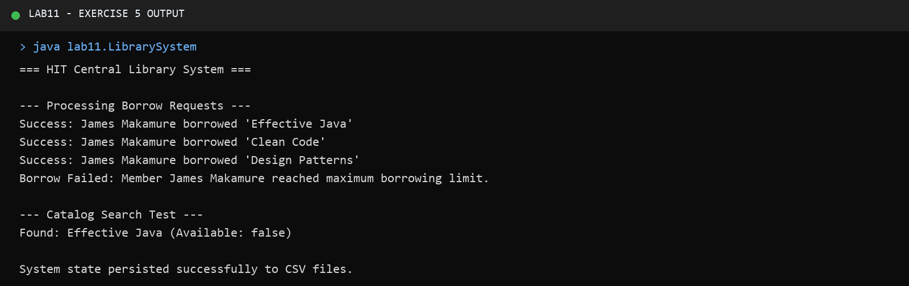

## Conclusions & Explanations

* **Creational & Structural Patterns:** The Singleton pattern enforces a single instance for configuration management, while the Factory pattern isolates object instantiation logic from caller code.


* **Behavioral Patterns:** Strategy encapsulates interchangeable algorithms (such as fine calculation) behind a common interface, and Observer decouples subject state updates from member notification channels.


* **SOLID Architectural Alignment:** The mini-project integrates Single Responsibility (decoupled classes), Open/Closed Principle (extensible items/strategies), and Interface Segregation (clean contracts like `Borrowable` and `Observer`), resulting in a maintainable, enterprise-ready Java codebase.
