# Lab 1: Classes and Objects

## Objectives
* Define a class with fields and methods.
* Create objects with `new` and access members.
* Understand object references and `null`.[cite: 1]

## Exercises & Code
**Exercise 1: Car.java**
```java
package lab1;

public class Car {
    String brand;
    int year;
    int mileage;

    
    void display() {
        System.out.println("Brand: " + brand);
        System.out.println("Year: " + year);
        System.out.println("Mileage: " + mileage);
    }


    public static void main(String[] args) {
        Car car1 = new Car();
        car1.brand = "Toyota";
        car1.year = 2020;
        car1.mileage = 15000;

        Car car2 = new Car();
        car2.brand = "Honda";
        car2.year = 1999;
        car2.mileage = 30000;

        Car car3 = new Car();
        car3.brand = "Ford";
        car3.year = 2021;
        car3.mileage = 10000;

        System.out.println("Car 1 Details:");
        car1.display();

        System.out.println("\nCar 2 Details:");
        car2.display();

        System.out.println("\nCar 3 Details:");
        car3.display();

    }
}


```
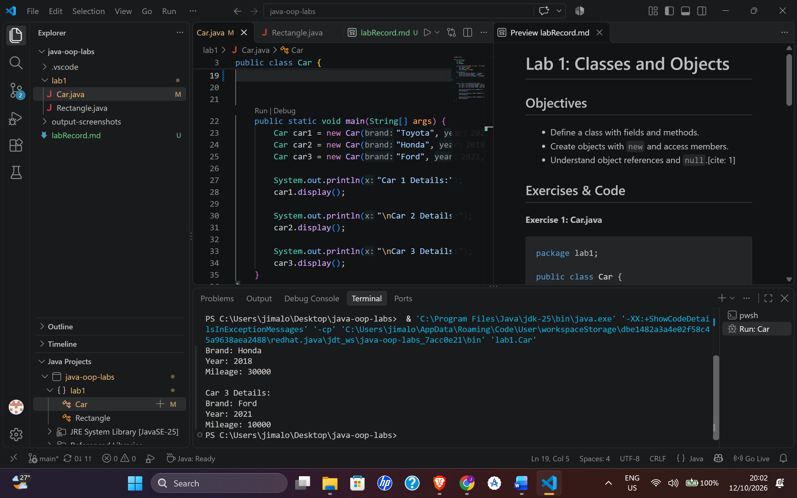


**Exercise 2: Antique**
```java
package lab1;

public class Car {
    String brand;
    int year;
    int mileage;

    
    void display() {
        System.out.println("Brand: " + brand);
        System.out.println("Year: " + year);
        System.out.println("Mileage: " + mileage);
    }

    boolean isAntique() {
        return 2026 - year > 25;
    }

    public static void main(String[] args) {
        Car car1 = new Car();
        car1.brand = "Toyota";
        car1.year = 2020;
        car1.mileage = 15000;

        Car car2 = new Car();
        car2.brand = "Honda";
        car2.year = 1999;
        car2.mileage = 30000;

        Car car3 = new Car();
        car3.brand = "Ford";
        car3.year = 2021;
        car3.mileage = 10000;

        System.out.println("Car 1 Details:");
        car1.display();

        System.out.println("\nCar 2 Details:");
        car2.display();

        System.out.println("\nCar 3 Details:");
        car3.display();

        System.out.println("\nIs Car 1 an antique? " + car1.isAntique());
        System.out.println("Is Car 2 an antique? " + car2.isAntique());

    }
}


```
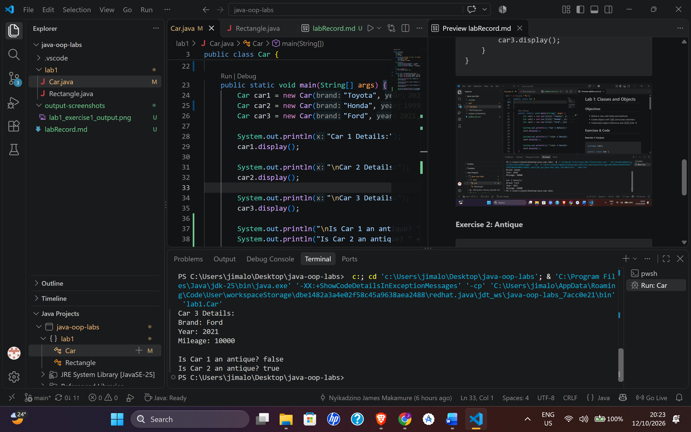

**Exercise 3 Rectangle Array**
```java
package lab1;

public class Rectangle {
    double length;
    double width;


    double area() {
        return length * width;
    }

    double perimeter() {
        return 2 * (length + width);
    }

    public static void main(String[] args) {
        Rectangle[] rectangles = new Rectangle[5];
        rectangles[0] = new Rectangle();
        rectangles[0].length = 5.0;
        rectangles[0].width = 3.0;
        rectangles[1] = new Rectangle();
        rectangles[1].length = 7.5;
        rectangles[1].width = 4.5;
        rectangles[2] = new Rectangle();
        rectangles[2].length = 10.0;
        rectangles[2].width = 6.0;
        rectangles[3] = new Rectangle();
        rectangles[3].length = 12.5;
        rectangles[3].width = 8.5;
        rectangles[4] = new Rectangle();
        rectangles[4].length = 15.0;
        rectangles[4].width = 10.0;

        int maxAreaIndex = 0;
        for (int i = 0; i < rectangles.length; i++) {
            if (rectangles[i].area() > rectangles[maxAreaIndex].area()) {
                maxAreaIndex = i;
            }
        }
        System.out.println("Rectangle with the largest area: " + (maxAreaIndex + 1) + " (Area: " + rectangles[maxAreaIndex].area() + ")");

    }
}

```
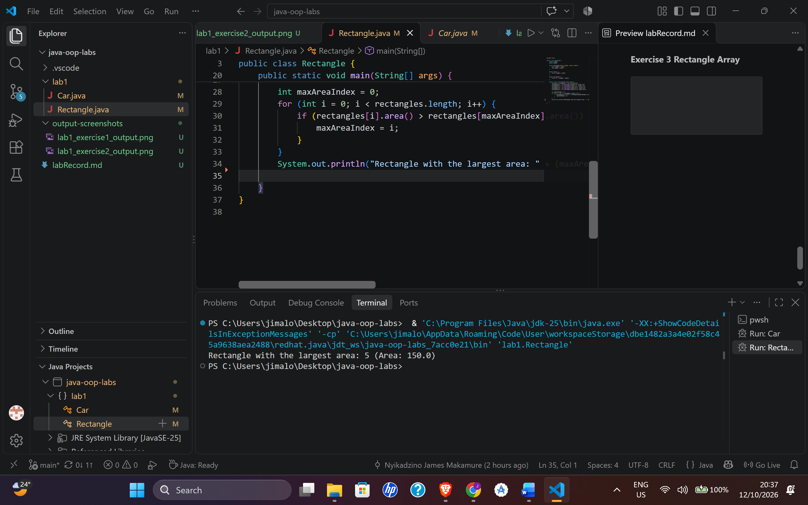

**Exercise 4 References**
```java
package lab1;

public class Rectangle {
    double length;
    double width;


    double area() {
        return length * width;
    }

    double perimeter() {
        return 2 * (length + width);
    }

    public static void main(String[] args) {
        Rectangle[] rectangles = new Rectangle[5];
        rectangles[0] = new Rectangle();
        rectangles[0].length = 5.0;
        rectangles[0].width = 3.0;
        rectangles[1] = new Rectangle();
        rectangles[1].length = 7.5;
        rectangles[1].width = 4.5;
        rectangles[2] = new Rectangle();
        rectangles[2].length = 10.0;
        rectangles[2].width = 6.0;
        rectangles[3] = new Rectangle();
        rectangles[3].length = 12.5;
        rectangles[3].width = 8.5;
        rectangles[4] = new Rectangle();
        rectangles[4].length = 15.0;
        rectangles[4].width = 10.0;

        int maxAreaIndex = 0;
        for (int i = 0; i < rectangles.length; i++) {
            if (rectangles[i].area() > rectangles[maxAreaIndex].area()) {
                maxAreaIndex = i;
            }
        }
        System.out.println("Rectangle with the largest area: " + (maxAreaIndex + 1) + " (Area: " + rectangles[maxAreaIndex].area() + ")");

        Rectangle r1 = new Rectangle();
        r1.length = 5.0;
        r1.width = 3.0;
        Rectangle r2 = r1;
        r2.width = 10.0;
        System.out.println("Width of r1: " + r1.width); 
    }
}

```
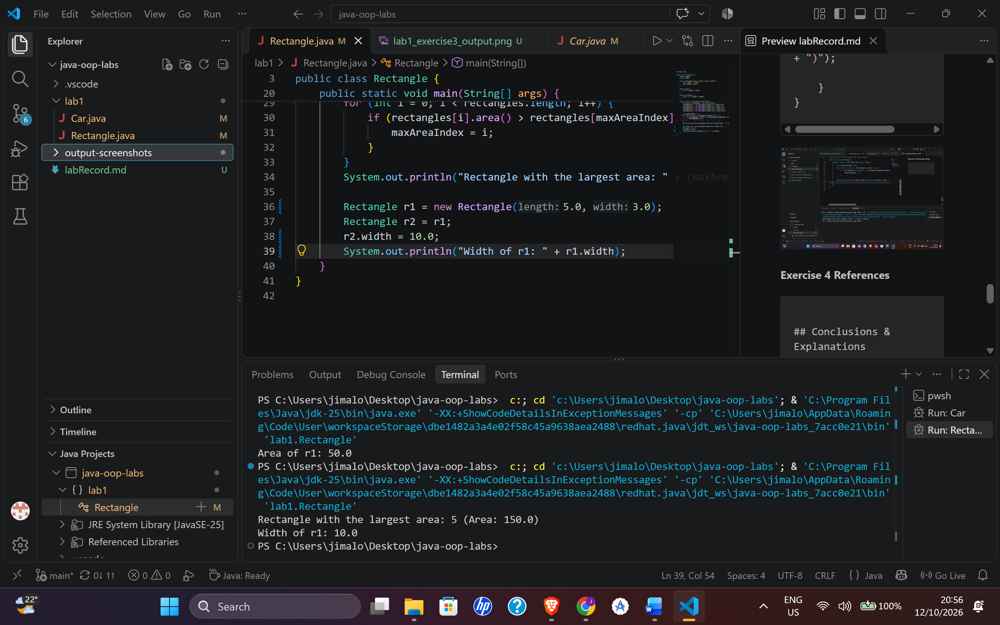


**Exercise 5: Chained Expressions & `null`**

`Address.java`
```java
package lab1;

public class Address {
    String city;

}
```
`Person.java`
```java

package lab1;

public class Person {
    String name;
    int age;
    Address address;

public static void main(String[] args) {
        Person person1 = new Person();
        person1.name = "Alice";
        person1.age = 30;
        Address address1 = new Address();
        address1.city = "Harare";
        person1.address = address1;

        System.out.println("Person 1 Details:");
        System.out.println("Name: " + person1.name);
        System.out.println("Age: " + person1.age);
        System.out.println("City: " + person1.address.city);

        person1.address = null;
        System.out.println("Address object: " + person1.address);

        System.out.println("City: " + person1.address.city);
    }

}
```


## Conclusions & Explanations (Lab 1)
* ### Exercise 4 (References):
    When executing `Rectangle r2 = r1;`, Java copies the memory address reference rather than duplicating the object. Because `r1` and `r2` point to the same instance on the heap, modifying `r2.width` alters `r1.width`.   
* ### Exercise 5 (Chained Expressions & `null`):
    Chained dot expressions (e.g., `person1.address.city`) navigate nested object references. When `person1.address` is set to `null`, attempting to access `.city` causes a runtime `NullPointerException` because no object exists at that reference.

# Lab 2: Constructors, the this Keyword and static Members

## Objectives
* Initialise objects safely using constructors.
* Overload constructors and chain them with `this(...)`.
* Use `this` to distinguish fields from parameters.
* Explain the difference between instance members and static members.
* Use `static` and instance initialiser blocks.

## Exercises and Code
**Exercise 1: Circle Constructor**
```java
package lab2;

public class Circle {
    
    double radius;

    public Circle(double radius) {
        this.radius = radius;
    }

    public Circle() {
        this(1.0);   
    }
    
    public static void main(String[] args) {
        Circle c1 = new Circle(5.0);
        Circle c2 = new Circle();
        System.out.println("Circle 1 radius: " + c1.radius);
        System.out.println("Circle 2 radius: " + c2.radius);
    }
    


}

```
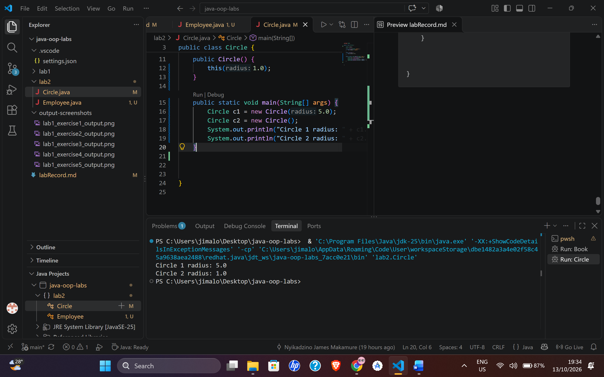
**Exercise 2: Circle Counter**
```java
package lab2;


public class Circle {
    private static int counter = 0;
    double radius;

    {
        counter++;
    }

    public Circle(double radius) {
        this.radius = radius;
    }

    public Circle() {
        this(1.0);   
    }
    public static int getCounter() {
        return counter;
    }
    
    public static void main(String[] args) {
        Circle c1 = new Circle(5.0);
        Circle c2 = new Circle();
        System.out.println("Circle 1 radius: " + c1.radius);
        System.out.println("Circle 2 radius: " + c2.radius);
        System.out.println("Number of circles created: " + Circle.getCounter());

    }
    


}

```
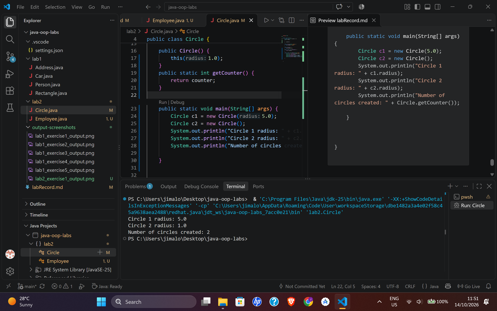

**Exercise 3: Employee Override**
```java
package lab2;

public class Employee {
    private String name;
    private double salary;
    private String department;
    private final int employeeId;
    private static int counter = 0;

    {
        counter++;
        employeeId = counter;
    }
    public Employee(String name, double salary, String department) {
        this.name = name;
        this.salary = salary;
        this.department = department;   
    }
    public Employee(String name, double salary) {
        this(name, salary, "General");
    }
    public Employee(String name) {
        this(name, 50000.0, "General");
    }

    public Employee(Employee other) {
        this(other.name, other.salary, other.department);
    }
    public int getEmployeeId() {
        return employeeId;
    }

    public static void main(String[] args) {
        Employee e1 = new Employee("Alice", 60000.0, "HR");
        Employee e2 = new Employee("Bob", 70000.0);
        Employee e3 = new Employee("Charlie");
        Employee e4 = new Employee(e1);

        System.out.println("Employee 1 ID: " + e1.getEmployeeId());
        System.out.println("Employee 2 ID: " + e2.getEmployeeId());
        System.out.println("Employee 3 ID: " + e3.getEmployeeId());
        System.out.println("Employee 4 ID: " + e4.getEmployeeId());

        e1.salary = 65000.0; // Modify salary of e1
        System.out.println("Employee 1 new salary: " + e1.salary);
        System.out.println("Employee 4 salary (should be unchanged): " + e4.salary);
    }

}
```
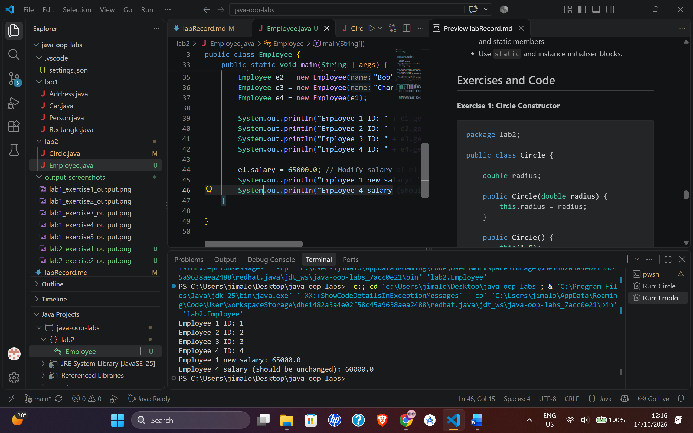

**Exercise 4: Prediction**
```java
package lab2;

public class Predict {
    static {
        System.out.println("Static Block 1");
    }

    static {
        System.out.println("Static Block 2");
    }

    {
        System.out.println("Instance Block 1");
    }

    {
        System.out.println("Instance Block 2");
    }

    public Predict() {
        System.out.println("Constructor");
    }

    public static void main(String[] args) {
        System.out.println("--- First Object ---");
        new Predict();
        System.out.println("--- Second Object ---");
        new Predict();
    }
}
```
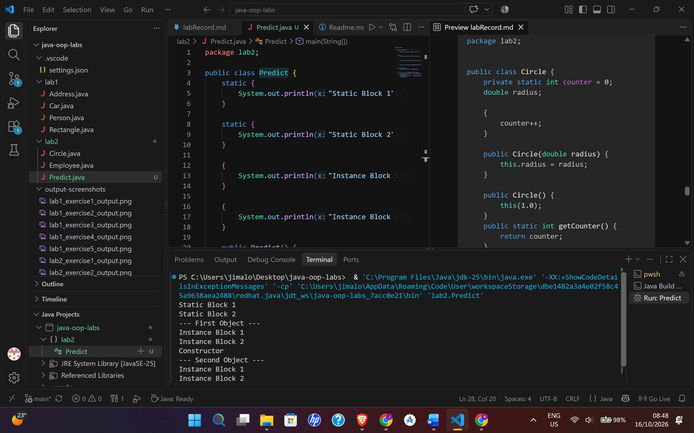


**Exercise 5: Temperature**
```java
package lab2;

public class Temperature {
    private final double kelvin;

    
    private Temperature(double kelvin) {
        this.kelvin = kelvin;
    }

    
    public static Temperature fromCelsius(double celsius) {
        return new Temperature(celsius + 273.15);
    }

    
    public static Temperature fromFahrenheit(double fahrenheit) {
        return new Temperature((fahrenheit - 32) * 5 / 9 + 273.15);
    }

    public double getCelsius() {
        return kelvin - 273.15;
    }

    public double getFahrenheit() {
        return (kelvin - 273.15) * 9 / 5 + 32;
    }

    public static void main(String[] args) {
        Temperature t1 = Temperature.fromCelsius(25.0);
        Temperature t2 = Temperature.fromFahrenheit(98.6);

        System.out.printf("t1 in Fahrenheit: %.2f°F%n", t1.getFahrenheit());
        System.out.printf("t2 in Celsius: %.2f°C%n", t2.getCelsius());
    }
}
```
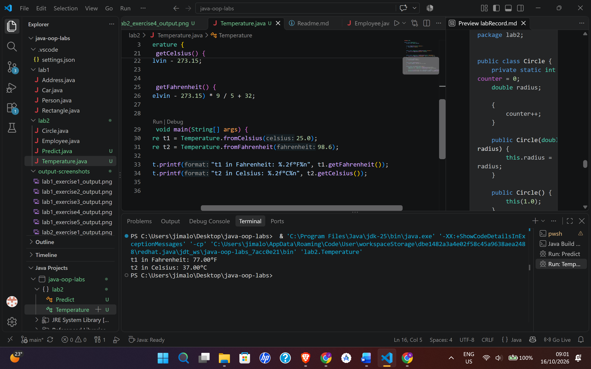


## Conclusions & Explanations (Lab 2)
* ### Initialization Order:
    Static blocks execute only once when the class is loaded by the JVM. Instance blocks execute prior to constructor execution each time an object is instantiated.

* ### Copy Constructor Behavior:
    The copy constructor copies field values into a new memory instance, ensuring modifications to the original object do not impact the copied object.

* ### Static Factory Methods vs. Constructors:
    Static factory methods provide named construction (e.g., `fromCelsius` vs `fromFahrenheit`), which avoids signature conflicts when multiple factory operations accept identical parameter types.


# Lab 3: Encapsulation and Access Modifiers

## Objectives
- Hide internal data with `private` fields and expose it through controlled methods.
- Apply the four access levels correctly.
- Enforce validation rules (class invariants) inside setters and constructors.
- Design classes that cannot be put into an invalid state.

## Exercises and Code

**Exercises 1 & 2: Student**
```java
package lab3;

public class Student {
    private String name;
    private double marks;

    public Student(String name, double marks) {
        setName(name);
        setMarks(marks);
    }

    public String getName() {
        return name;
    }

    public void setName(String name) {
        if (name == null || name.isBlank()) {
            throw new IllegalArgumentException("Name cannot be empty.");
        }
        this.name = name.trim();
    }

    public double getMarks() {
        return marks;
    }

    public void setMarks(double marks) {
        if (marks < 0 || marks > 100) {
            throw new IllegalArgumentException("Marks must be between 0 and 100.");
        }
        this.marks = marks;
    }

    public String getGrade() {
        if (marks >= 75) return "A";
        if (marks >= 65) return "B";
        if (marks >= 50) return "C";
        return "F";
    }

    public static void main(String[] args) {
        Student s1 = new Student("Tariro", 82.5);
        System.out.printf("Student: %s | Marks: %.1f | Grade: %s%n", s1.getName(), s1.getMarks(), s1.getGrade());

        try {
            s1.setMarks(105); 
        } catch (IllegalArgumentException e) {
            System.out.println("Validation caught: " + e.getMessage());
        }
    }
}
```

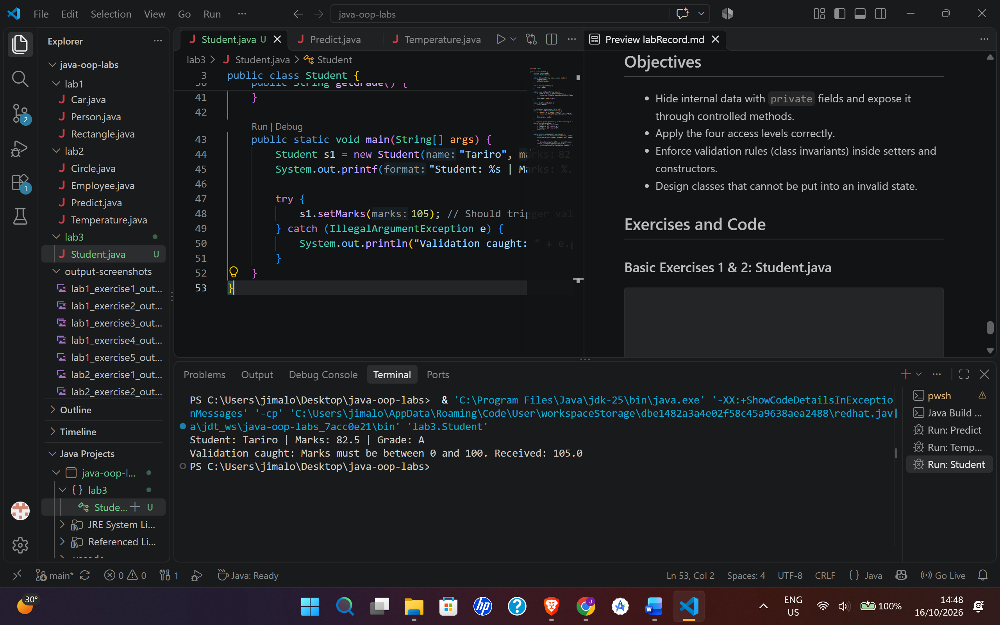

**Exercise 3: Bank Account**

```java
package lab3;

import java.util.ArrayList;
import java.util.Collections;
import java.util.List;

public class BankAccount {
    private final String accountNumber;
    private String ownerName;
    private double balance;
    private final List<String> history = new ArrayList<>();

    public BankAccount(String accountNumber, String ownerName, double initialDeposit) {
        if (initialDeposit < 0) throw new IllegalArgumentException("Deposit cannot be negative");
        this.accountNumber = accountNumber;
        this.ownerName = ownerName;
        this.balance = initialDeposit;
        history.add("Account opened with $" + initialDeposit);
    }

    public double getBalance() { return balance; }

    public List<String> getHistory() {
        return Collections.unmodifiableList(history);
    }

    public void deposit(double amount) {
        if (amount <= 0) throw new IllegalArgumentException("Deposit must be positive");
        balance += amount;
        history.add("Deposited $" + amount);
    }

    public static void main(String[] args) {
        BankAccount acc = new BankAccount("ACC-001", "James", 500);
        acc.deposit(200);
        System.out.println("Balance: $" + acc.getBalance());
        System.out.println("History: " + acc.getHistory());
        
        try {
            acc.getHistory().clear(); 
        } catch (UnsupportedOperationException e) {
            System.out.println("Encapsulation protected the history list.");
        }
    }
}
```
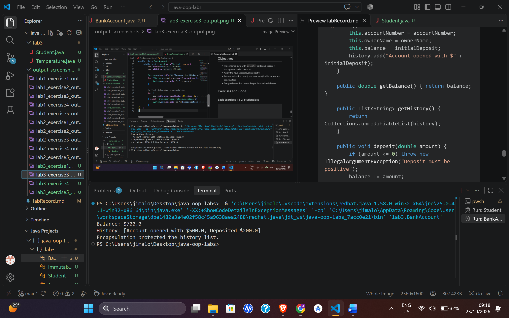

**Exercise 4: ImmutablePerson**

```java
package lab3;

public final class ImmutablePerson {
    private final String idNumber;
    private final String fullName;

    public ImmutablePerson(String idNumber, String fullName) {
        if (idNumber == null || fullName == null) {
            throw new IllegalArgumentException("Fields cannot be null");
        }
        this.idNumber = idNumber;
        this.fullName = fullName;
    }

    public String getIdNumber() { return idNumber; }
    public String getFullName() { return fullName; }

    public static void main(String[] args) {
        ImmutablePerson p = new ImmutablePerson("63-294810-A-18", "Nyasha Makamure");
        System.out.println("ID: " + p.getIdNumber());
        System.out.println("Name: " + p.getFullName());
    }
}
```
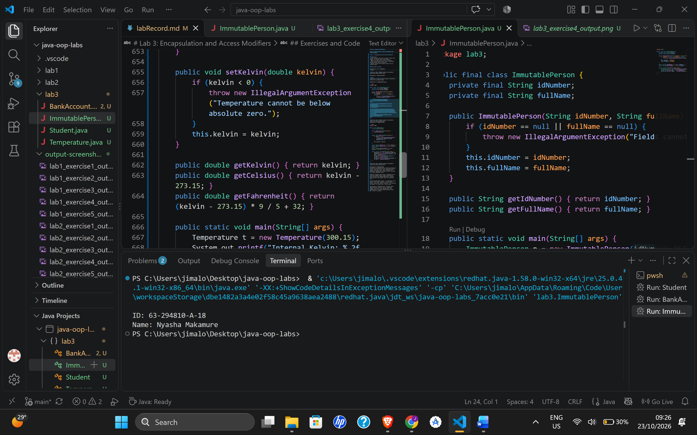

**Exercise 5: Temperature**

```java
package lab3;

public class Temperature {
    private double kelvin;

    public Temperature(double kelvin) {
        setKelvin(kelvin);
    }

    public void setKelvin(double kelvin) {
        if (kelvin < 0) {
            throw new IllegalArgumentException("Temperature cannot be below absolute zero.");
        }
        this.kelvin = kelvin;
    }

    public double getKelvin() { return kelvin; }
    public double getCelsius() { return kelvin - 273.15; }
    public double getFahrenheit() { return (kelvin - 273.15) * 9 / 5 + 32; }

    public static void main(String[] args) {
        Temperature t = new Temperature(300.15);
        System.out.printf("Internal Kelvin: %.2f K%n", t.getKelvin());
        System.out.printf("Exposed Celsius: %.2f °C%n", t.getCelsius());
        System.out.printf("Exposed Fahrenheit: %.2f °F%n", t.getFahrenheit());
    }
}
```
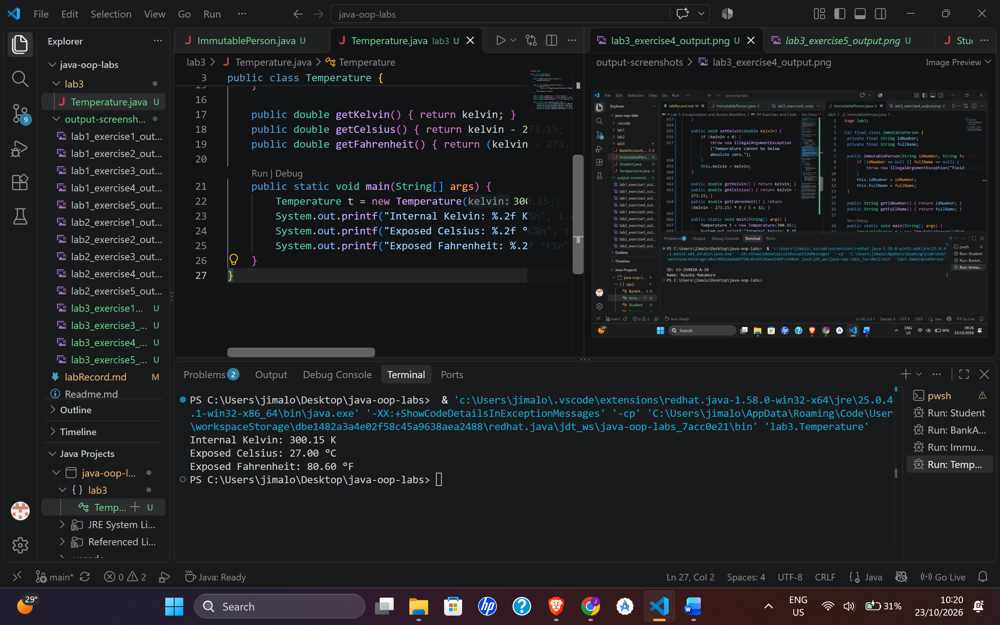

## Conclusions & Explanations
**Validation & Computed State:** Enforcing bounds in setters prevents objects from entering invalid states (like marks over 100). Methods like `getGrade()` dynamically compute results instead of storing redundant data.

**Defensive Copying:** Returning a reference to an internal mutable object leaks encapsulation. Using `Collections.unmodifiableList()` ensures that external code cannot alter the internal list.

**Designing Immutable Classes:** An immutable class uses a `final` class modifier, `private final` fields, and omits setters entirely. This ensures the object is locked into a valid state.

**Abstraction in Encapsulation:** Internal data representation (Kelvin) can be completely hidden. The caller uses `getCelsius()` and `getFahrenheit()` without knowing those fields don't exist in memory.